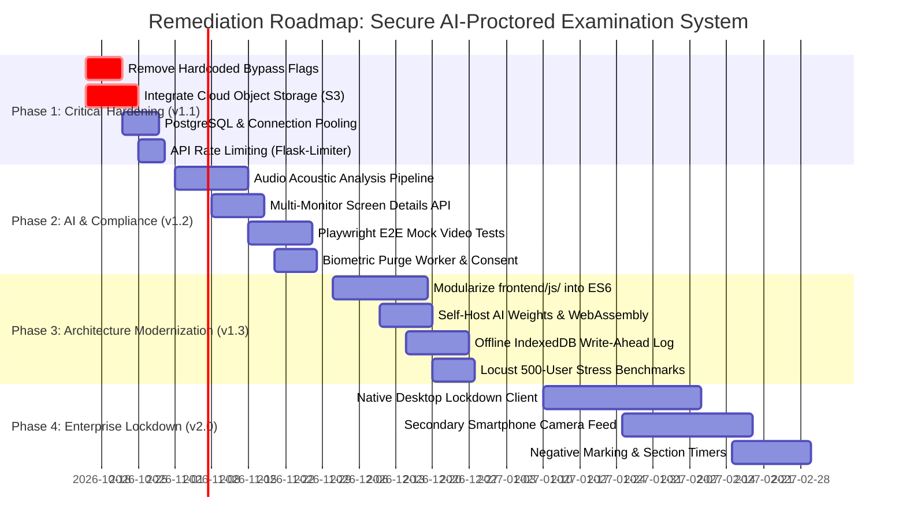

# GAP ANALYSIS REPORT: SECURE AI-PROCTORED EXAMINATION SYSTEM
## Comprehensive Functional, Architectural, Security, and Testing Gap Analysis

---

## 1. Executive Summary

### 1.1 Document Overview
| Field | Specification |
| :--- | :--- |
| **System Name** | Secure AI-Proctored Examination System |
| **Document Type** | Gap Analysis & Remediation Strategy Report |
| **Document Identifier** | GAP-SECURE-EXAM-V1.0 |
| **Associated Baseline** | `Secure_AI_Proctored_Exam_System_FRD.md` (v1.0.0) |
| **Target Codebase** | `D:/secure-exam-system` |
| **Effective Date** | October 12, 2026 |
| **Status** | Approved / Baselined |

### 1.2 Purpose & Context
This Gap Analysis Report provides an objective, rigorous, and evidence-based assessment of the disparity between the **Target Enterprise Architecture / Academic Examination Standards** and the **Current As-Is Codebase Implementation** of the Secure AI-Proctored Examination System.

The findings documented herein are derived from a full static code analysis of the backend (`Flask`, `SQLAlchemy`, 13 models, 7 blueprints, 36 API endpoints, 4 core service modules), the client interface (`HTML5`, `Tailwind CSS`, `frontend/js/app.js` containing ~2,000 lines of monolithic JavaScript), and the automated test suite (`tests/test_exam_system.py`, 26 test cases).

### 1.3 Key Findings Summary
1. **Core Capabilities Fully Functional**: User authentication, role-based access control (Admin vs. Student), course isolation (Python, Java, Aptitude, Drive), exam creation, question management with option deduplication, secure randomized exam delivery, authoritative server-calculated timer synchronization, and multi-threaded PDF scorecard generation are implemented and operational.
2. **Proctoring Engine Capabilities Active**: Client-side MediaPipe FaceMesh (head pose estimation / yaw-pitch-roll tracking), COCO-SSD object detection (mobile phone, multiple persons), and browser sandbox enforcement (fullscreen exit, tab switching, copy/paste prevention) are integrated and actively communicate with backend violation pipelines.
3. **Primary Critical Vulnerability / Gaps**:
   - **Bypass Flags in Backend Engine**: Hardcoded operational flags (`DISABLE_FACE_MISMATCH`, `DISABLE_EXAM_TERMINATION`, `DISABLE_MULTIPLE_PERSON`) temporarily set to `True` in `backend/services/violation_engine.py` to prevent false-positive auto-terminations during pilot testing.
   - **Ephemeral Filesystem on Cloud PaaS**: Evidence snapshots and student profile pictures are written to local disk directories (`backend/uploads/evidence/`), which are destroyed on Render/Heroku container restarts without cloud object storage (AWS S3 / Google Cloud Storage).
   - **Client-Side AI Inference Surface**: All AI computer vision models execute in candidate browser memory via WebAssembly/WebGL, leaving the system vulnerable to headless browser spoofing, DevTools script injection, and virtual camera feeds without OS-level lockdown.
   - **Database Concurrency Limitations**: SQLite file-level locking poses high bottleneck risks under concurrent submission spikes (e.g., 200+ students submitting within the same 5-second window).

---

## 2. Gap Classification & Severity Matrix

Every identified gap is classified across four severity tiers based on risk to exam integrity, candidate experience, data security, and operational reliability:

| Severity Level | Definition | Impact on Examination | Target Resolution Window |
| :---: | :--- | :--- | :---: |
| **CRITICAL (P0)** | Flaw fundamentally undermines academic integrity, causes data loss, or halts exam execution. | Exam compromise, data loss on server restart. | Immediate (Pre-Production) |
| **HIGH (P1)** | Major limitation in scalability, AI reliability, or operational administration. | High false-positive rate, scaling bottlenecks. | Sprint 1-2 (Next Release) |
| **MEDIUM (P2)** | Architectural technical debt, lack of automated testing, or compliance oversight. | Reduced maintainability, manual audit burden. | Sprint 3-4 (v1.5) |
| **LOW (P3)** | Minor usability enhancement, cosmetic imperfection, or non-blocking optimization. | Minor UX friction. | v2.0 Roadmap |

---

## 3. Detailed Gap Findings by Architectural Domain

```
+-----------------------------------------------------------------------------------+
|                        GAP ANALYSIS ARCHITECTURAL DOMAINS                         |
+-----------------------------------------------------------------------------------+
|  [Domain 1: AI Proctoring & Malpractice Enforcement]                              |
|  [Domain 2: Cloud Infrastructure, Storage & Database Concurrency]                 |
|  [Domain 3: Frontend Architecture, Security & Client Integrity]                   |
|  [Domain 4: Examination Lifecycle, Timer & Offline Resilience]                     |
|  [Domain 5: Security, Biometrics, Privacy & Regulatory Compliance]                |
|  [Domain 6: Quality Assurance, Automated Testing & Verification Coverage]          |
+-----------------------------------------------------------------------------------+
```

---

### Domain 1: AI Proctoring & Malpractice Enforcement

#### GAP-PROC-01: Hardcoded Bypass Flags in Violation Engine
- **Severity**: **CRITICAL (P0)**
- **As-Is Codebase State**:
  In `backend/services/violation_engine.py` (lines 20–28), three critical enforcement flags are hardcoded:
  ```python
  DISABLE_FACE_MISMATCH = True
  DISABLE_EXAM_TERMINATION = True
  DISABLE_MULTIPLE_PERSON = True
  ```
- **Consequence**:
  - If a student leaves their desk or a proxy test-taker sits in front of the camera, the system does not log face mismatches or terminate the exam.
  - When maximum violation thresholds (e.g., 5 head turns, 3 tab switches) are breached, the server issues warning responses but suppresses automatic exam termination because `DISABLE_EXAM_TERMINATION = True`.
  - Academic integrity cannot be guaranteed in high-stakes proctoring while these bypasses exist.
- **Root Cause**: Added during student pilot trials to prevent network jitter or poor lighting from prematurely terminating student attempts before warning calibration was finalized.
- **Remediation Plan**:
  1. Relocate these flags from static Python source code to the database-driven `ExamSecurityConfig` model (`backend/models/security_config.py`).
  2. Provide administrative UI toggles on `exam_detail.html` allowing proctors to set policies per exam (Strict Proctored, Lenient/Practice, or Disabled).
  3. Default all flags to `False` in production production environments.

---

#### GAP-PROC-02: Absence of Secondary Camera / Multi-Monitor Detection
- **Severity**: **HIGH (P1)**
- **As-Is Codebase State**:
  `frontend/js/app.js` initializes a single `getUserMedia` stream targeting the user-facing laptop webcam.
- **Consequence**:
  - Students can connect an external HDMI monitor or TV behind the laptop, duplicate or extend the desktop, and have an accomplice read questions or display answers without detection.
  - Blind spots exist beneath the camera field of view (e.g., holding a mobile phone directly below the keyboard).
- **Remediation Plan**:
  1. Utilize the experimental `window.getScreenDetails()` Screen Details API where supported in Chromium to detect multiple physical displays and reject exam entry if `screens.length > 1`.
  2. Implement a secondary mobile camera feed (v2.0 roadmap) where candidate scans a QR code with their mobile phone, placing it at a 45-degree side angle to capture hands, keyboard, and desk area.

---

#### GAP-PROC-03: Lack of Audio / Acoustic Malpractice Monitoring
- **Severity**: **HIGH (P1)**
- **As-Is Codebase State**:
  The system requests video access (`{ video: true, audio: false }`) and performs no acoustic analysis.
- **Consequence**:
  - Candidates can wear hidden Bluetooth earphones or have a proxy whisper answers in the room without triggering any violation.
- **Remediation Plan**:
  1. Update `getUserMedia` constraints to `{ video: true, audio: true }`.
  2. Implement an audio analysis pipeline using the Web Audio API (`AudioContext`, `AnalyserNode`) to detect decibel spikes exceeding ambient baseline noise, indicating speech or conversational cheating.
  3. Transmit acoustic violation events (`AUDIO_WHISPER`, `BACKGROUND_SPEECH`) to `/api/proctoring/violation`.

---

#### GAP-PROC-04: CDN Dependency for AI Neural Network Weights
- **Severity**: **MEDIUM (P2)**
- **As-Is Codebase State**:
  `exam.html` loads TensorFlow.js, `@tensorflow-models/coco-ssd`, and `@mediapipe/face_mesh` directly from external public CDNs:
  ```html
  <script src="https://cdn.jsdelivr.net/npm/@tensorflow/tfjs"></script>
  <script src="https://cdn.jsdelivr.net/npm/@tensorflow-models/coco-ssd"></script>
  <script src="https://cdn.jsdelivr.net/npm/@mediapipe/face_mesh"></script>
  ```
- **Consequence**:
  - In institutional environments with restricted firewalls, high latency, or CDN outages, exam loading stalls indefinitely at "Initializing Proctoring Engine...".
  - Model weights (~15 MB) are downloaded on every new session if browser caching is cleared, consuming excessive bandwidth in multi-student labs.
- **Remediation Plan**:
  1. Download and self-host model weight binaries and WebAssembly files in `backend/static/vendor/models/`.
  2. Implement a Service Worker to cache model weights offline.

---

### Domain 2: Cloud Infrastructure, Storage & Database Concurrency

#### GAP-INFRA-01: Ephemeral Filesystem Storage for Evidence Images
- **Severity**: **CRITICAL (P0)**
- **As-Is Codebase State**:
  `backend/services/evidence_service.py` saves violation webcam captures and student verification photos directly to the server's local filesystem:
  ```python
  UPLOAD_DIR = os.path.join(current_app.root_path, 'uploads', 'evidence')
  ```
- **Consequence**:
  - On cloud container platforms like Render, Heroku, or AWS Fargate, containers are ephemeral and reboot frequently (during deploys, health checks, or sleep cycles).
  - When the container restarts, all saved evidence photos (`.jpg`) are permanently deleted.
  - While database rows in `evidence_records` persist, their `file_path` values point to non-existent local files, rendering PDF audit reports and admin evidence previews broken (`404 Not Found`).
- **Remediation Plan**:
  1. Abstract file persistence behind an Object Storage Service interface (`backend/services/storage_service.py`).
  2. Implement AWS S3 or Cloudflare R2 bucket integration using `boto3`.
  3. Store pre-signed S3 URLs or bucket keys in `evidence_records.file_path`.

---

#### GAP-INFRA-02: SQLite Concurrency Bottleneck in Production
- **Severity**: **HIGH (P1)**
- **As-Is Codebase State**:
  The system defaults to SQLite (`sqlite:///database/exam_portal.db`) unless `DATABASE_URL` is configured.
- **Consequence**:
  - SQLite uses database-level locking for write operations.
  - When 100+ students submit answers or heartbeat proctoring pings concurrently, SQLite throws `sqlite3.OperationalError: database is locked`.
  - Attempts can hang, resulting in dropped violation telemetry or failed exam submissions.
- **Remediation Plan**:
  1. Mandate PostgreSQL (`psycopg2-binary`) for production deployment.
  2. Configure connection pooling with SQLAlchemy (`pool_size=20`, `max_overflow=10`, `pool_recycle=1800`).
  3. Add automated Alembic migration scripts (`migrations/`) for schema versioning.

---

### Domain 3: Frontend Architecture, Security & Client Integrity

#### GAP-FRONT-01: Monolithic Frontend JavaScript Architecture
- **Severity**: **MEDIUM (P2)**
- **As-Is Codebase State**:
  `frontend/js/app.js` is a single file exceeding 2,000 lines containing:
  - Authentication state & token management.
  - Proctoring engine setup (MediaPipe & COCO-SSD).
  - Window event handlers (fullscreen, blur, visibility change).
  - Exam rendering & answer state tracking.
  - Timer countdown math and autosave synchronization.
  - Admin dashboards, notification polling, and student portal logic.
- **Consequence**:
  - High cognitive overhead for onboarding new developers.
  - Risk of regression: modifying timer code can inadvertently break proctoring initialization.
  - No modular bundling (Webpack / Vite), tree-shaking, or type checking (TypeScript).
- **Remediation Plan**:
  1. Refactor `frontend/js/` into ES6 modules:
     - `core/auth.js`
     - `proctoring/faceMesh.js`, `proctoring/objectDetector.js`, `proctoring/sandbox.js`
     - `exam/timer.js`, `exam/questionPalette.js`, `exam/submission.js`
     - `admin/dashboard.js`, `admin/registrationManager.js`
  2. Integrate Vite or ESBuild for production minification and source maps.

---

#### GAP-FRONT-02: Client-Side Sandbox Tamper Susceptibility
- **Severity**: **HIGH (P1)**
- **As-Is Codebase State**:
  Browser security relies on standard DOM events:
  - `document.addEventListener('visibilitychange', ...)`
  - `window.addEventListener('blur', ...)`
  - `document.addEventListener('fullscreenchange', ...)`
- **Consequence**:
  - Tech-savvy students can open Chrome DevTools (if not disabled before launch), override native functions (e.g., `document.hasFocus = () => true`), or freeze JavaScript execution via debugger breakpoints.
  - Virtual camera software (OBS Virtual Camera, ManyCam) can feed looped pre-recorded videos to bypass webcam proctoring.
- **Remediation Plan**:
  1. Integrate native Safe Exam Browser (SEB) configuration or an Electron-based desktop lockdown wrapper.
  2. Enforce virtual camera detection by inspecting `MediaDeviceInfo.label` and video stream frame rate anomalies.

---

### Domain 4: Examination Lifecycle, Timer & Offline Resilience

#### GAP-LIFE-01: Lack of Local Encrypted Answer Caching During Network Loss
- **Severity**: **MEDIUM (P2)**
- **As-Is Codebase State**:
  Answers are transmitted via immediate `POST /api/attempts/<id>/answer` calls upon option selection.
- **Consequence**:
  - If a student experiences a 30-second WiFi disconnect, option clicks display warning alerts or fail to persist.
  - If the page is refreshed during a network outage before submission, unpersisted answers may be lost.
- **Remediation Plan**:
  1. Implement an encrypted `IndexedDB` or `localStorage` write-ahead log on the client.
  2. Queue un-acknowledged answer updates in an offline sync queue.
  3. Replay queued answers sequentially upon network restoration before triggering final submission.

---

#### GAP-LIFE-02: Absence of Section-Wise Timers and Negative Marking
- **Severity**: **LOW (P3)**
- **As-Is Codebase State**:
  The system enforces a single global `duration_minutes` per exam attempt. Grading calculates `(score / total_marks) * 100` without penalty points.
- **Consequence**:
  - Competitive entrance exams requiring sectional time limits (e.g., 20 mins for Math, 20 mins for Verbal) cannot be hosted.
  - Negative marking schemes (e.g., -0.25 marks per incorrect answer) are not supported.
- **Remediation Plan**:
  1. Add `section` and `negative_marks` columns to `questions` table.
  2. Update `evaluation.py` to deduct `negative_marks` for incorrect selections.

---

### Domain 5: Security, Biometrics, Privacy & Regulatory Compliance

#### GAP-SEC-01: Missing Rate Limiting on API Endpoints
- **Severity**: **HIGH (P1)**
- **As-Is Codebase State**:
  The Flask application does not configure `Flask-Limiter` or reverse-proxy rate limits.
- **Consequence**:
  - Malicious clients can flood `/api/proctoring/violation` with thousands of fake violation alerts to overload the server or consume database storage.
  - Brute-force attacks against `/api/auth/login` are unthrottled.
- **Remediation Plan**:
  1. Integrate `Flask-Limiter` backed by Redis.
  2. Apply rate limits:
     - `/api/auth/login`: 5 requests / minute.
     - `/api/proctoring/violation`: 30 requests / minute / attempt.
     - `/api/attempts/<id>/answer`: 60 requests / minute / attempt.

---

#### GAP-SEC-02: Biometric Data Privacy & Retention Policy Enforcement
- **Severity**: **HIGH (P1)**
- **As-Is Codebase State**:
  `users.face_encoding` stores 128-dimensional facial biometric vectors. `evidence_records` stores high-resolution webcam snapshots indefinitely.
- **Consequence**:
  - Non-compliance with data privacy frameworks (EU GDPR Article 9, California CCPA/CPRA, India Digital Personal Data Protection Act 2023).
  - Storing biometric identifiers without explicit candidate retention timeframes creates institutional legal liability.
- **Remediation Plan**:
  1. Implement a Data Retention Worker (`backend/tasks/purge_evidence.py`) that automatically deletes evidence images 30 days after exam publication unless flagged for disciplinary review.
  2. Add an explicit biometric consent modal on the student registration and exam entry screens.

---

### Domain 6: Quality Assurance, Automated Testing & Verification Coverage

#### GAP-TEST-01: Zero Automated Client-Side Frontend Tests
- **Severity**: **HIGH (P1)**
- **As-Is Codebase State**:
  Automated tests in `tests/test_exam_system.py` consist of 26 backend integration tests. There are zero automated unit or end-to-end tests for `frontend/js/app.js`, `exam.html`, or webcam proctoring logic.
- **Consequence**:
  - Regressions in frontend timer math, option radio selection, or camera streaming can only be discovered through manual human testing.
  - Browser-specific rendering quirks (e.g., Safari vs. Chrome MediaPipe WebGL compatibility) go undetected.
- **Remediation Plan**:
  1. Implement end-to-end testing using Playwright with mock webcam video inputs.
  2. Add Vitest or Jest unit tests for client-side timer reconciliation algorithms and answer state handlers.

---

#### GAP-TEST-02: Absence of Automated Load / Stress Tests
- **Severity**: **MEDIUM (P2)**
- **As-Is Codebase State**:
  No Locust, k6, or JMeter load testing suites exist in the repository.
- **Consequence**:
  - The performance ceiling under concurrent exam load (e.g., 500 students pinging proctoring violations and submitting exams simultaneously) is unquantified.
- **Remediation Plan**:
  1. Add a `tests/load/locustfile.py` script simulating concurrent exam takers, question navigation, proctoring heartbeats, and final submissions.

---

## 4. Gap Severity Summary & Prioritization Matrix

| Gap ID | Description | Severity | Impacted Component | Target Milestone |
| :--- | :--- | :---: | :--- | :---: |
| **GAP-PROC-01** | Hardcoded bypass flags in `violation_engine.py` | **CRITICAL (P0)** | Backend Proctoring Engine | v1.1.0 |
| **GAP-INFRA-01** | Ephemeral local storage for evidence images on cloud PaaS | **CRITICAL (P0)** | Evidence Service / Storage | v1.1.0 |
| **GAP-PROC-02** | Absence of multi-monitor / secondary camera detection | **HIGH (P1)** | Client Sandbox & Media | v1.2.0 |
| **GAP-PROC-03** | Lack of audio / acoustic whispering detection | **HIGH (P1)** | Client AI Engine / Backend | v1.2.0 |
| **GAP-INFRA-02** | SQLite concurrency bottlenecks in production | **HIGH (P1)** | Database Architecture | v1.1.0 |
| **GAP-FRONT-02** | Client-side DOM sandbox tamper susceptibility | **HIGH (P1)** | Client Integrity | v2.0.0 |
| **GAP-SEC-01** | Missing API rate limiting on login & proctoring endpoints | **HIGH (P1)** | Security Middleware | v1.1.0 |
| **GAP-SEC-02** | Biometric data privacy retention policy & auto-purge | **HIGH (P1)** | Data Governance | v1.2.0 |
| **GAP-TEST-01** | Zero automated frontend / end-to-end tests | **HIGH (P1)** | QA & Test Suite | v1.2.0 |
| **GAP-PROC-04** | Reliance on public CDNs for AI neural network weights | **MEDIUM (P2)** | Client AI Engine | v1.3.0 |
| **GAP-FRONT-01** | Monolithic 2,000+ line `frontend/js/app.js` architecture | **MEDIUM (P2)** | Frontend Codebase | v1.3.0 |
| **GAP-LIFE-01** | Lack of local encrypted answer queue for network drops | **MEDIUM (P2)** | Exam State Machine | v1.3.0 |
| **GAP-TEST-02** | Absence of automated load / concurrency stress tests | **MEDIUM (P2)** | QA / Performance | v1.3.0 |
| **GAP-LIFE-02** | Absence of section-wise timers and negative marking | **LOW (P3)** | Exam Evaluation Engine | v2.0.0 |

---

## 5. Strategic Remediation Roadmap



---

## 6. Document Sign-off & Acknowledgement

This Gap Analysis represents an authentic technical evaluation of the `D:/secure-exam-system` codebase as of October 12, 2026. The identified gaps provide a clear, risk-prioritized engineering backlog for academic presentation, production deployment, and future release cycles.

| Evaluator Role | Printed Name | Signature | Review Date |
| :--- | :--- | :---: | :---: |
| **Lead Software Architect** | ____________________________ | ______________________ | ____/____/2026 |
| **Information Security Analyst** | ____________________________ | ______________________ | ____/____/2026 |
| **Quality Assurance Lead** | ____________________________ | ______________________ | ____/____/2026 |
