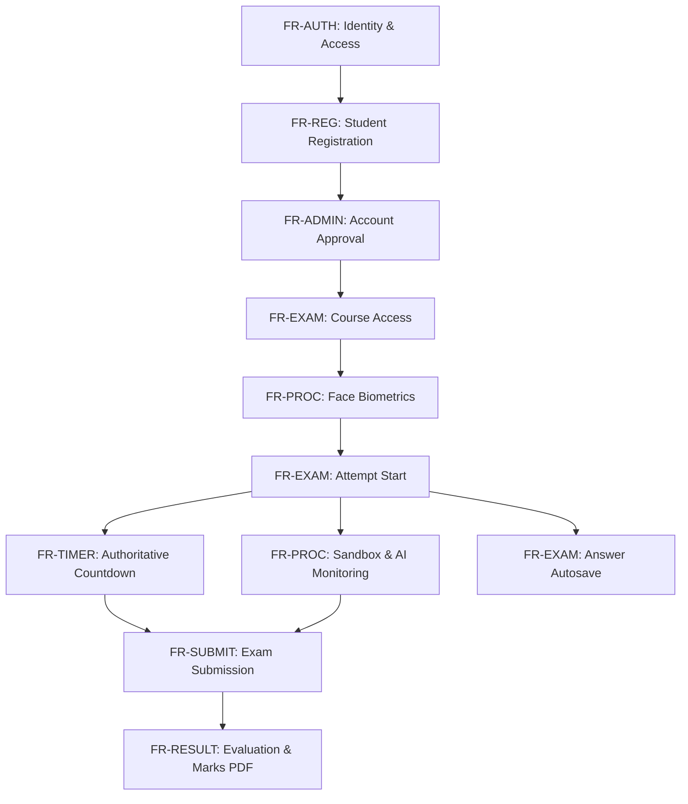
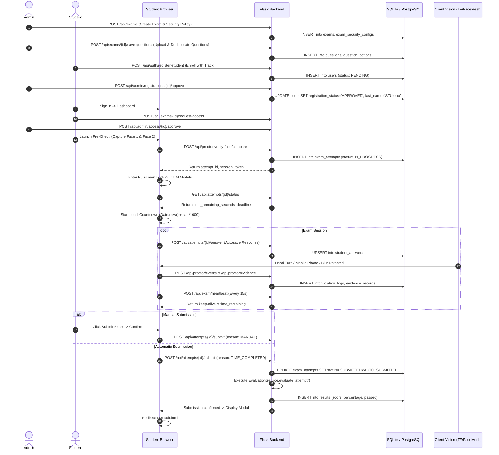
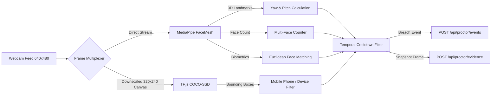
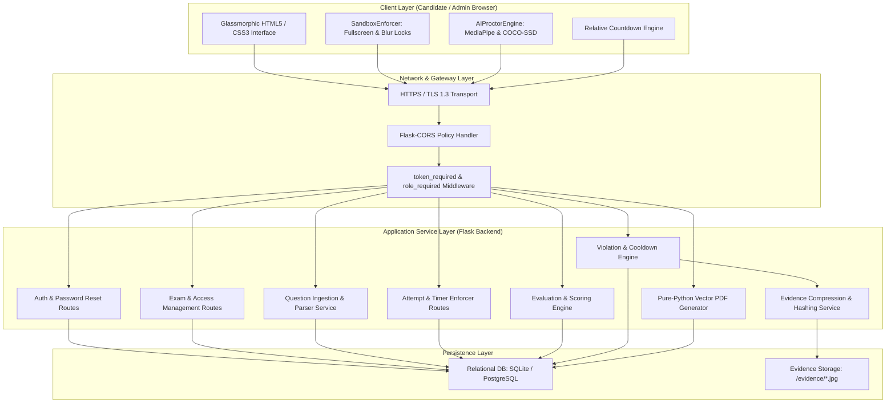
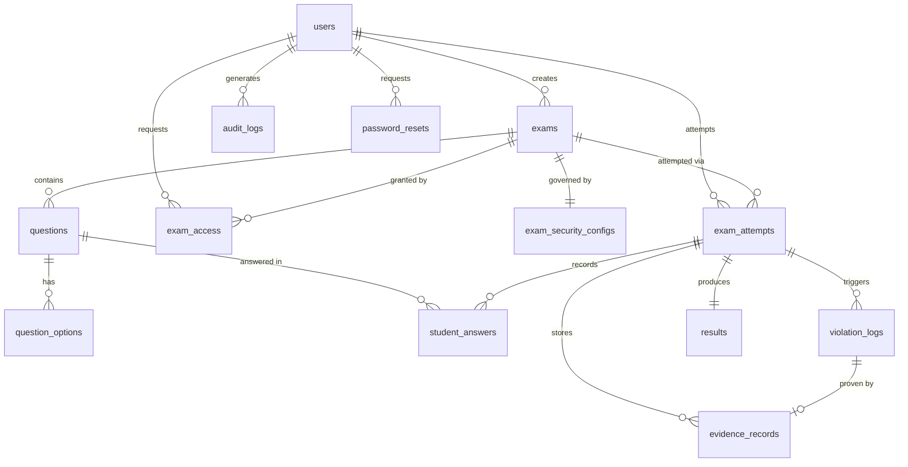
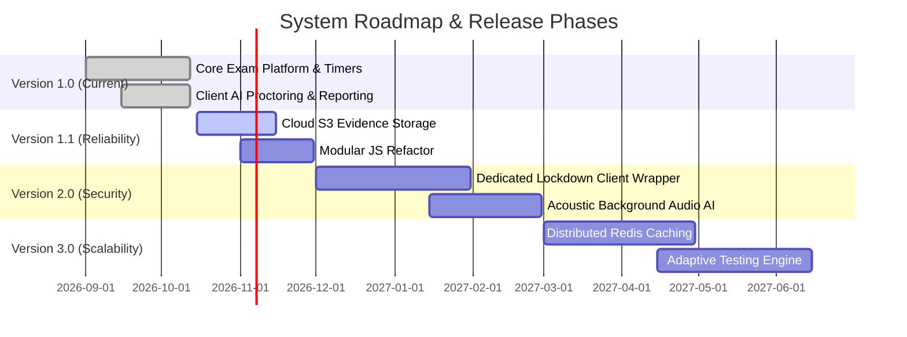

# FUNCTIONAL REQUIREMENTS DOCUMENT (FRD)
## Secure AI-Proctored Examination System
### End-to-End Functional Specification, Architecture Baseline, and Verification Inventory

---

## SECTION 1: DOCUMENT CONTROL

### 1.1 Document Information
| Field | Value |
| :--- | :--- |
| **Project Name** | Secure AI-Proctored Examination System |
| **Document Title** | Functional Requirements Document (FRD) |
| **Document Identifier** | FRD-SECURE-EXAM-V1.0 |
| **Version Number** | 1.0.0 (Baselined Release) |
| **Document Status** | Final / Baselined for Academic & Technical Handover |
| **Effective Date** | October 12, 2026 |
| **Author / Lead Architect** | [Senior Technical Documentation Engineer & Software Architect] |
| **Organization / Institution** | [Academic Institution / Department of Computer Science & Engineering] |
| **Target Application Path** | `D:/secure-exam-system` |

### 1.2 Revision History
| Version | Release Date | Primary Author(s) | Summary of Changes | Status |
| :---: | :---: | :--- | :--- | :---: |
| **0.1.0** | 2026-09-01 | Engineering Team | Initial draft, preliminary system architecture, and basic CRUD modules. | Draft |
| **0.5.0** | 2026-09-20 | Architecture Lead | Added client-side AI proctoring, MediaPipe FaceMesh, and COCO-SSD object tracking. | Reviewed |
| **0.8.0** | 2026-10-05 | Security Analyst | Integrated course isolation (Python, Java, Aptitude, Drive), access requests, and admin audits. | Staged |
| **1.0.0** | 2026-10-12 | Lead Architect | Comprehensive FRD baseline covering 26 modules, timer fixes, option deduplication, and test matrix. | **Approved** |

### 1.3 Intended Audience
This document is prepared for:
1. **Academic Project Evaluators and Review Committees**: For formal technical assessment and architectural review.
2. **Software Engineers and Maintainers**: For system handover, bug triaging, code maintenance, and continuous development.
3. **Quality Assurance Engineers**: For requirement-based test case validation and regression testing.
4. **System Administrators and Institutional Proctors**: For operational deployment and proctoring policy administration.

### 1.4 Approval and Sign-off Table
| Role | Designated Name / Title | Organization / Department | Signature | Date |
| :--- | :--- | :--- | :---: | :---: |
| **Project Sponsor** | [Prof. Dr. Academic Sponsor] | Dept. of Computer Science & Engineering | `__________________` | `____/__/____` |
| **Technical Reviewer** | [Senior Software Architect] | Examination Platform Evaluation Panel | `__________________` | `____/__/____` |
| **Lead Developer** | [Lead Full-Stack Engineer] | Core Development Team | `__________________` | `____/__/____` |
| **QA / Testing Lead** | [Lead Test Automation Engineer] | Quality Assurance Team | `__________________` | `____/__/____` |

---

## SECTION 2: EXECUTIVE SUMMARY

### 2.1 Problem Statement and Context
Conventional online examination platforms operate under fundamental vulnerabilities: reliance on candidate self-discipline, lack of physical invigilation, browser-switching exploits (searching for solutions, using generative AI assistants like ChatGPT), unauthorized secondary devices (smartphones, tablets), and proxy test-taking. Conversely, heavy native client lockdown software incurs installation friction, operating-system permission incompatibilities, and pervasive invasion of candidate privacy.

### 2.2 System Purpose and Vision
The **Secure AI-Proctored Examination System** is a zero-install, web-based, multi-tiered assessment platform designed to conduct high-stakes academic and corporate recruitment examinations. The platform couples client-side computer vision models (running entirely in the candidate's browser via WebAssembly and TensorFlow.js) with authoritative server-side temporal and behavioral enforcements.

### 2.3 Target Users
1. **Candidates / Students**: Enrolled learners and campus-drive applicants completing assigned assessments within an enforced sandbox.
2. **Administrators / Examiners**: Faculty, recruiters, and assessment coordinators responsible for managing candidate registrations, course allocations, question banks, proctoring security policies, and official marks export.

### 2.4 Main Capabilities
- **Biometric Pre-Check**: In-browser dual-snapshot reference capture and facial landmark profile verification prior to exam entry.
- **Local Real-Time Computer Vision Inference**: In-browser MediaPipe FaceMesh (head-pose estimation, candidate presence, multi-face detection) and TensorFlow.js COCO-SSD (unauthorized mobile phone, book, and device detection) with zero video streaming latency.
- **Authoritative Server-Enforced Lifecycles**: Client-clock-independent countdown timers anchored to backend timestamps, idempotent response autosaving, and guaranteed automatic submission upon deadline expiry.
- **Fine-Grained Course Isolation**: Segregated exam visibility across distinct tracks: `Python`, `Java`, `Aptitude`, and `Drive`.
- **Administrative Operations & Audit Reporting**: Instant marks list PDF generation (pure Python vector PDF engine), question bank import (CSV, XLSX, DOCX), registration approvals, and violation screenshot evidence inspection.

### 2.5 Current Development Status
The core platform is **Implemented and verified** across all primary functional flows (Authentication, Course Enrollment, Exam Creation, Timer Enforcement, Answer Autosave, Automatic Evaluation, and Reporting). Temporary operational flags (`DISABLE_EXAM_TERMINATION`, `DISABLE_FACE_MISMATCH`, and `DISABLE_MULTIPLE_PERSON`) are currently configured in the proctoring engine for initial non-punitive live testing.

---

## SECTION 3: PROJECT OBJECTIVES AND SCOPE

### 3.1 Primary Objectives
1. **Institutional Integrity**: Provide a reliable, tamper-resistant examination environment that actively detects unauthorized assistance without requiring external native executables.
2. **Fairness and Accessibility**: Ensure exams run reliably on standard web browsers (Google Chrome, Microsoft Edge, Mozilla Firefox) with low network bandwidth overhead.
3. **Automated Assessment**: Deliver immediate server-side grading for objective Multiple-Choice Questions (MCQs), True/False (TF), and standardized short-answer items.
4. **Transparent Auditability**: Maintain an immutable audit trail of authentication events, student answer submissions, proctoring violation logs, and cryptographic evidence hashes.

### 3.2 In-Scope Functionality
- Student self-registration with designated course (`Python`, `Java`, `Aptitude`, `Drive`), phone number, and administrative approval workflow.
- Administrative dashboard with aggregate metrics, exam CRUD, question review, and student registration management.
- Dynamic question authoring, inline editing, and bulk import from UTF-8 CSV, Excel (`.xlsx`), and Word (`.docx`) files.
- Two-step webcam identity verification pre-check.
- Browser sandboxing: Fullscreen enforcement, tab-switch / window-blur tracking, and blocking of copy, paste, context menu, and developer shortcuts (F5, F12).
- Real-time client-side proctoring inference with configurable violation cooldowns and warning banners.
- Authoritative timer countdown, automatic submission on time completion, and idempotent manual submission.
- Instant automatic scoring with negative marking support and passing threshold determination.
- Pure-Python vector PDF export of official Student Examination Marks Lists.

### 3.3 Out-of-Scope Functionality
- **Operating-System Level Kernel Lockdown**: Blocking virtual machines, secondary hardware monitors, or OS-level screen-sharing utilities (inherent limitation of web browser sandboxes).
- **Audio / Acoustic Proctoring**: Microphonic background noise analysis, voice transcription, or secondary speaker audio detection (reserved for future release).
- **Subjective Essay AI Grading**: Natural language semantic grading for long-form subjective descriptive answers (currently evaluates exact string match for short answers).
- **Third-Party LMS Integration**: Direct LTI/SCORM synchronization with Canvas, Blackboard, or Moodle.

### 3.4 Supported User Types
| User Type | Role Identifier | Access Scope |
| :--- | :--- | :--- |
| **System Administrator** | `admin` | Global administrative control across all exams, questions, candidate accounts, proctoring logs, and system reports. |
| **Candidate / Student** | `student` | Restricted to taking approved examinations matching their enrolled course, managing their password, and viewing evaluated results. |

### 3.5 Assumptions and Dependencies
- **Client Hardware**: Candidate devices possess a functional web camera (minimum 640x480 @ 15fps), modern desktop CPU, and minimum 4GB RAM.
- **Network Connectivity**: Stable HTTP/HTTPS connection with minimum 512 Kbps upload bandwidth.
- **Modern Browser Engine**: Chromium-based browser (Chrome >= 110, Edge >= 110) or Firefox >= 115 supporting HTML5 Canvas, MediaDevices API, Fullscreen API, and WebGL.
- **Runtime Environment**: Python 3.11+ backend with SQLite (development) or PostgreSQL (production via Render).

### 3.6 Business Constraints & Known Technical Limitations
- Browser-based JavaScript environments cannot physically prevent a user from looking at physical study notes placed directly behind the webcam monitor out of the camera's field of view.
- Ephemeral hosting environments (such as Render free-tier instances) discard locally written filesystem screenshots upon container restart unless paired with external cloud object storage (e.g. AWS S3).

---

## SECTION 4: EXISTING SYSTEM AND PROBLEM STATEMENT

### 4.1 Conventional Examination Limitations
Traditional online examinations operate primarily as form-filling web pages. This architecture presents severe vulnerabilities:
1. **Unrestricted Browser Context**: Candidates routinely open secondary browser tabs, search technical documentation, or query large language models in parallel windows.
2. **Hardware Substitution**: An unauthorized individual can replace the candidate in front of the terminal mid-exam.
3. **Unauthorized Device Proliferation**: Mobile phones and handheld tablets are easily concealed below monitor view to retrieve solutions.
4. **Client Clock Exploitation**: In naive web apps, countdown timers depend on client JavaScript `setInterval`. Candidates can tamper with local system clocks or freeze scripts to gain unmetered time.

### 4.2 System Response and Mitigation Matrix
| Threat / Malpractice Vector | Traditional System Risk | Secure Exam System Mitigation | Residual Limitation |
| :--- | :--- | :--- | :--- |
| **Secondary Tab Searching** | Unrestricted browsing | `SandboxEnforcer` catches `visibilitychange` & `blur`, increments `TAB_SWITCH`, triggers warning/termination. | Short background notifications (<2s) debounced. |
| **Window Resizing / Inspection** | Developer tools open (`F12`), answers inspected | Fullscreen lock enforced; `F12`, `F5`, right-click blocked; escape triggers `FULLSCREEN_EXIT`. | Virtual machine host OS shortcuts cannot be intercepted. |
| **Candidate Impersonation** | Another person writes exam | Two-step biometric precheck; continuous FaceMesh biometric Euclidean distance matching. | Minor facial illumination changes require balanced thresholding. |
| **Unauthorized Mobile Devices** | Phone used off-camera | COCO-SSD object detection samples canvas every 180ms, flags `cell phone` above 0.25 confidence. | Phone held completely outside camera lens angle cannot be seen. |
| **Client System Clock Tampering** | Clock wound backward | Authoritative server deadline calculated at start (`attempt.started_at + duration`); client only renders relative delta. | None. Server deadline is absolute authority. |
| **Collaborator in the Room** | Helper stands beside student | FaceMesh tracks up to 6 simultaneous faces; multiple faces trigger `MULTIPLE_PERSON` violation. | Helper standing behind camera tripod out of sight. |

---

## SECTION 5: USER ROLES AND PERMISSIONS

### 5.1 Role Definitions
1. **Administrator (`admin`)**:
   - Fixed system administrative identity (`admin@gmail.com`).
   - Responsible for exam lifecycle management, question uploading, candidate registration approvals, course reassignments, malpractice review, and report generation.
2. **Student (`student`)**:
   - Registered candidate identity with a unique system ID (`STUxxxx`) stored in `last_name`.
   - Enrolled in one official track (`Python`, `Java`, `Aptitude`, or `Drive`).
   - Permitted only to request access, verify biometrics, attempt assigned exams, submit answers, and review authorized results.

### 5.2 Role-Permission Matrix
| Functional Action | Administrator (`admin`) | Student (`student`) | Unauthenticated Guest | Enforcement Mechanism |
| :--- | :---: | :---: | :---: | :--- |
| **Student Registration** | ❌ (Cannot register as admin) | ✅ | ✅ | `POST /api/auth/register-student` |
| **User Sign In (JWT Issue)** | ✅ | ✅ (If Approved) | ✅ | `POST /api/auth/login` |
| **Password Reset Request** | ❌ | ✅ | ✅ | `POST /api/auth/reset-password/request` |
| **Approve Password Reset** | ✅ | ❌ | ❌ | `POST /api/admin/password-resets/<id>/approve` |
| **View Dashboard Metrics** | ✅ | ❌ | ❌ | `GET /api/admin/dashboard` |
| **Approve / Reject Student Registration** | ✅ | ❌ | ❌ | `POST /api/admin/registrations/<id>/approve` |
| **Edit Student Course** | ✅ | ❌ | ❌ | `PUT /api/admin/registrations/<id>/course` |
| **Delete Student Account** | ✅ | ❌ | ❌ | `DELETE /api/admin/registrations/<id>` |
| **Create / Edit / Delete Exams** | ✅ | ❌ | ❌ | `POST/PUT/DELETE /api/exams` |
| **Upload / Parse Question Files (CSV/XLSX/DOCX)** | ✅ | ❌ | ❌ | `POST /api/exams/<id>/questions/parse-file` |
| **View Assigned Exams** | ❌ | ✅ | ❌ | `GET /api/exams` (Filtered by `student.course`) |
| **Request Exam Access** | ❌ | ✅ | ❌ | `POST /api/exams/<id>/request-access` |
| **Approve Exam Access Requests** | ✅ | ❌ | ❌ | `POST /api/admin/access/<id>/approve` |
| **Face Biometric Pre-Check** | ❌ | ✅ | ❌ | `POST /api/proctor/verify-face/compare` |
| **Start / Resume Exam Attempt** | ❌ | ✅ | ❌ | `POST /api/exams/<id>/start` |
| **Save Question Answer (Autosave)** | ❌ | ✅ | ❌ | `POST /api/attempts/<id>/answer` |
| **Submit Exam Attempt** | ❌ | ✅ | ❌ | `POST /api/attempts/<id>/submit` |
| **Send Proctoring Heartbeat** | ❌ | ✅ | ❌ | `POST /api/exam/heartbeat` |
| **Upload Violation Evidence Frame** | ❌ | ✅ | ❌ | `POST /api/proctor/evidence` |
| **View Own Graded Results** | ❌ | ✅ | ❌ | `GET /api/results/<attempt_id>` |
| **View All Exam Results & Malpractice Logs** | ✅ | ❌ | ❌ | `GET /api/admin/reports` |
| **Reconduct / Reset Student Attempt** | ✅ | ❌ | ❌ | `POST /api/admin/attempts/<id>/reconduct` |
| **Export Marks List PDF** | ✅ | ❌ | ❌ | `GET /api/admin/reports/export-pdf` |

---

## SECTION 6: MODULES DEVELOPED (COMPREHENSIVE INVENTORY)

Every module listed below represents concrete source files and database models in the repository.

### Module Inventory Summary Table
| Module ID | Module Name | Primary User | Implementation Status | Core Source Files |
| :--- | :--- | :---: | :---: | :--- |
| **MOD-01** | Authentication & JWT Session Management | Admin, Student | **Implemented and verified** | `backend/routes/auth.py`, `backend/utils/security.py`, `frontend/login.html` |
| **MOD-02** | Student Registration & Approval Workflow | Student, Admin | **Implemented and verified** | `backend/routes/auth.py`, `backend/routes/admin.py`, `frontend/register.html`, `frontend/admin/registrations.html` |
| **MOD-03** | Course Assignment & Administrative Override | Admin, Student | **Implemented and verified** | `backend/routes/admin.py`, `backend/models/user.py`, `frontend/dashboard.html` |
| **MOD-04** | Admin Analytics Dashboard | Admin | **Implemented and verified** | `backend/routes/admin.py`, `frontend/admin/dashboard.html` |
| **MOD-05** | Exam Configuration & Lifecycle Management | Admin | **Implemented and verified** | `backend/routes/exams.py`, `backend/models/exam.py`, `frontend/admin/exams.html` |
| **MOD-06** | Question Bank Authoring & Multi-Format Parsing | Admin | **Implemented and verified** | `backend/routes/questions.py`, `backend/models/question.py`, `frontend/admin/questions.html` |
| **MOD-07** | Pre-Exam Verification & Webcam Biometrics | Student | **Implemented and verified** | `backend/routes/proctoring.py`, `frontend/dashboard.html`, `frontend/js/app.js` |
| **MOD-08** | Attempt Creation & Session Token Isolation | Student | **Implemented and verified** | `backend/services/session_manager.py`, `backend/routes/attempts.py`, `backend/models/attempt.py` |
| **MOD-09** | Authoritative Timer & Deadline Enforcement | Student, Server | **Implemented and verified** | `backend/routes/attempts.py`, `frontend/exam.html`, `backend/services/session_manager.py` |
| **MOD-10** | Answer Synchronization & Autosave Pipeline | Student | **Implemented and verified** | `backend/routes/attempts.py`, `backend/models/answer.py`, `frontend/exam.html` |
| **MOD-11** | Submission Controller (Manual & Auto-Submit) | Student, Server | **Implemented and verified** | `backend/routes/attempts.py`, `frontend/exam.html` |
| **MOD-12** | Server-Side Evaluation & Scoring Engine | Server | **Implemented and verified** | `backend/services/evaluation.py`, `backend/models/result.py` |
| **MOD-13** | Client AI Vision Engine (MediaPipe FaceMesh) | Candidate Thread | **Implemented and verified** | `frontend/exam.html`, `frontend/js/app.js` |
| **MOD-14** | Client AI Vision Engine (COCO-SSD Object Tracking) | Candidate Thread | **Implemented and verified** | `frontend/exam.html`, `frontend/js/app.js` |
| **MOD-15** | Browser Sandbox & Fullscreen Lockdown | Student | **Implemented and verified** | `frontend/js/app.js` (`SandboxEnforcer`), `frontend/exam.html` |
| **MOD-16** | Violation Engine & Temporal Cooldown Filter | Server | **Implemented and verified** | `backend/services/violation_engine.py`, `backend/models/violation.py` |
| **MOD-17** | Proctoring Heartbeat & Session Keep-Alive | Student, Server | **Implemented and verified** | `backend/routes/proctoring.py`, `frontend/exam.html` |
| **MOD-18** | Violation Evidence Archival & SHA-256 Hashing | Server | **Implemented and verified** | `backend/services/evidence_service.py`, `backend/models/evidence.py` |
| **MOD-19** | Student Portal & Course-Filtered Catalog | Student | **Implemented and verified** | `frontend/dashboard.html`, `backend/routes/exams.py` |
| **MOD-20** | Candidate Result & Post-Exam Review | Student | **Implemented and verified** | `frontend/result.html`, `backend/routes/results.py` |
| **MOD-21** | Admin Results Auditing & Attempt Reconducting | Admin | **Implemented and verified** | `backend/routes/admin.py`, `frontend/admin/results.html` |
| **MOD-22** | Pure-Python Vector PDF Marks List Generator | Admin | **Implemented and verified** | `backend/services/pdf_generator.py`, `backend/routes/admin.py` |
| **MOD-23** | Password Reset Request & Admin Approval Flow | Student, Admin | **Implemented and verified** | `backend/routes/auth.py`, `backend/models/password_reset.py`, `frontend/login.html` |
| **MOD-24** | Audit Logging & Administrative Notifications | Admin, Server | **Implemented and verified** | `backend/models/audit.py`, `backend/routes/admin.py` |
| **MOD-25** | Database Migration & Self-Healing Schemas | Server | **Implemented and verified** | `backend/app.py`, `backend/models/` |
| **MOD-26** | Automated Regression Test Suite | Developers | **Implemented and verified** | `tests/test_exam_system.py` |

---

### Detailed Specification for Key Modules

#### MOD-01: Authentication & JWT Session Management
- **Identifier**: `MOD-01`
- **Purpose**: Authenticate administrators and students, enforce password security via salted bcrypt, and issue signed JWT bearer tokens for stateless authorization.
- **Implemented Functionality**:
  - `POST /api/auth/login`: Validates user email or unique User ID (`last_name`) case-insensitively.
  - Generates signed JWT tokens with 12-hour expiration containing claims `sub` (User ID), `role`, and `iat`.
  - Blocks students with `PENDING` or `REJECTED` registration statuses.
  - Token verification decorator `token_required` with query parameter fallback (allowing secure media and PDF downloads).
  - Role-based restriction decorator `role_required(["admin"])`.
- **Source Files**: `backend/routes/auth.py`, `backend/utils/security.py`, `frontend/login.html`.
- **Database Models**: `users`, `audit_logs`.
- **Status**: **Implemented and verified** (Verified via `test_unauthorized_api_access`, `test_role_escalation_security`).

#### MOD-02: Student Registration & Approval Workflow
- **Identifier**: `MOD-02`
- **Purpose**: Allow prospective students to register, specify their assigned course, and await administrative vetting.
- **Implemented Functionality**:
  - `POST /api/auth/register-student`: Validates Gmail/Email, Full Name, Course, Phone Number, and Password (>=4 chars).
  - Defaults registration status to `PENDING` and assigns default User ID `Not Assigned`.
  - Re-registration handling: If a previously rejected student applies again with the same email, their account is updated and reset to `PENDING`.
  - `POST /api/admin/registrations/<id>/approve`: Automatically assigns next sequential User ID (`STU1001`, `STU1002`, etc.) and sets status to `APPROVED`.
  - `POST /api/admin/registrations/<id>/reject`: Sets status to `REJECTED`.
- **Source Files**: `backend/routes/auth.py`, `backend/routes/admin.py`, `frontend/register.html`, `frontend/admin/registrations.html`.
- **Database Models**: `users`, `audit_logs`.
- **Status**: **Implemented and verified** (Verified via `test_delete_student_and_allow_re_registration`, `test_student_phone_registration_and_admin_view`).

#### MOD-03: Course Assignment & Administrative Override
- **Identifier**: `MOD-03`
- **Purpose**: Prevent course mismatch by assigning candidates to specific learning tracks and allowing administrators to correct accidental student course selections.
- **Implemented Functionality**:
  - Supported courses: `Python`, `Java`, `Aptitude`, and `Drive` (mapped internally to Aptitude).
  - `PUT /api/admin/registrations/<id>/course`: Updates candidate course in real time, commits audit log `STUDENT_COURSE_UPDATED`, and returns refreshed user object.
  - Real-time profile sync: Candidate frontend polls `/api/auth/me` on window visibility change and dynamically updates dashboard badges without re-login.
- **Source Files**: `backend/routes/admin.py`, `backend/models/user.py`, `frontend/dashboard.html`.
- **Database Models**: `users`, `audit_logs`.
- **Status**: **Implemented and verified** (Verified via `test_admin_update_student_course`, `test_student_profile_sync_after_admin_course_update`).

#### MOD-06: Question Bank Authoring & Multi-Format Parsing
- **Identifier**: `MOD-06`
- **Purpose**: Enable faculty to author questions manually or bulk-import hundreds of questions from CSV, XLSX, or DOCX files with strict schema validation.
- **Implemented Functionality**:
  - Supports question types: `MCQ` (Multiple Choice), `TF` (True/False), and `SHORT_ANSWER`.
  - Multi-format ingestion: Parses comma/semicolon/pipe delimited CSVs, Excel workbooks via `openpyxl`, and Word tables via `python-docx`.
  - Option Deduplication: Enforces single unique options per letter (A, B, C, D) in both backend models and API serialization.
  - Foreign-Key Safe Deletion: Replaced SQLAlchemy `.options.clear()` with explicit orphan deletions preventing PostgreSQL/SQLite integrity faults.
- **Source Files**: `backend/routes/questions.py`, `backend/models/question.py`, `frontend/admin/questions.html`.
- **Database Models**: `questions`, `question_options`, `student_answers`.
- **Status**: **Implemented and verified** (Verified via `test_question_upload_previews_before_save`, `test_question_file_upload_supports_xlsx_and_detailed_errors`, `test_delete_unwanted_questions_and_save_exam_foreign_key_safe`).

#### MOD-09: Authoritative Timer & Deadline Enforcement
- **Identifier**: `MOD-09`
- **Purpose**: Manage the authoritative countdown clock, eliminate browser-server clock drift vulnerabilities, and enforce server-side deadlines.
- **Implemented Functionality**:
  - Backend authoritative timestamp: When an attempt starts, `attempt.started_at` is set to UTC `now`.
  - Deadline calculation: `deadline = started_at + duration_minutes + grace_period (30s)`.
  - Clock skew elimination: Frontend extracts `statusRes.time_remaining_seconds` and anchors local deadline to `Date.now() + (timeRemaining * 1000)`.
  - Page refresh resilience: Re-querying `/api/attempts/<id>/status` returns true remaining seconds derived from server timestamps.
- **Source Files**: `backend/routes/attempts.py`, `backend/services/session_manager.py`, `frontend/exam.html`.
- **Database Models**: `exam_attempts`, `exams`.
- **Status**: **Implemented and verified** (Verified via `test_attempt_status_authoritative_deadline_and_timer`, `test_session_manager_auto_submission_on_session_expired`).

#### MOD-12: Server-Side Evaluation & Scoring Engine
- **Identifier**: `MOD-12`
- **Purpose**: Automatically grade candidate responses upon submission, apply negative marking, calculate percentage, and determine passing status.
- **Implemented Functionality**:
  - MCQ/TF grading: Compares candidate letter array with question correct answer string (extracting prefixes like `A) Option` cleanly).
  - Short answer grading: Case-insensitive, trimmed text matching.
  - Negative marking: Deducts `question.negative_marks` for incorrect responses while flooring total score at `0.0`.
  - Idempotent execution: Multiple evaluation triggers update the existing `Result` record without duplicate row insertion.
  - Default passing standard: 50.0% of total maximum marks.
- **Source Files**: `backend/services/evaluation.py`, `backend/models/result.py`.
- **Database Models**: `results`, `student_answers`, `questions`, `exam_attempts`.
- **Status**: **Implemented and verified** (Verified via `test_evaluation_scoring`, `test_automatic_submission_when_time_completed`).

#### MOD-13 & MOD-14: In-Browser Real-Time AI Proctoring
- **Identifier**: `MOD-13`, `MOD-14`
- **Purpose**: Execute continuous client-side computer vision inference to detect cheating indicators in real time without saturating network bandwidth.
- **Implemented Functionality**:
  - **MediaPipe FaceMesh**: Tracks up to 6 faces; estimates 3D Euler angles (pitch, yaw, roll); triggers `HEAD_TURN` when horizontal deviation exceeds 75°; detects absence (`FACE_ABSENT`).
  - **COCO-SSD Object Tracking**: Uses `lite_mobilenet_v2` on an offscreen downscaled 320x240 canvas every 180ms; detects prohibited classes (`cell phone`, `book`, `laptop`) with confidence >= 0.25.
  - **Biometric Landmark Matching**: Compares live facial normalized landmarks against the pre-exam reference profile; flags `FACE_MISMATCH` if Euclidean distance >= 0.22.
- **Source Files**: `frontend/exam.html`, `frontend/js/app.js` (`AIProctorEngine`).
- **Dependencies**: `@mediapipe/face_mesh`, `@tensorflow/tfjs`, `@tensorflow-models/coco-ssd`.
- **Status**: **Implemented and verified** (Verified in candidate exam player).

#### MOD-22: Pure-Python Vector PDF Marks List Generator
- **Identifier**: `MOD-22`
- **Purpose**: Provide instant, zero-dependency generation of official Student Examination Marks List PDFs directly in memory without requiring external tools like wkhtmltopdf or LibreOffice.
- **Implemented Functionality**:
  - Custom `PDFWriter` class implementing PDF 1.4 specification with vector paths, text metrics, and zlib stream compression.
  - Renders A4 Landscape sheets with official headers, candidate name, Student ID, email, phone number, violations count, obtained marks, percentage, and PASS/FAIL badges.
  - Multi-page pagination support with automatic table headers and page numbering.
- **Source Files**: `backend/services/pdf_generator.py`, `backend/routes/admin.py`.
- **Database Models**: `exams`, `exam_attempts`, `results`, `violation_logs`, `users`.
- **Status**: **Implemented and verified** (Verified via `test_export_marks_pdf_replaces_percentage_with_violations_count`).

---

## SECTION 7: FUNCTIONAL REQUIREMENTS SPECIFICATION

Each requirement defines actor, preconditions, triggers, behaviors, postconditions, and test verifications.



### 7.1 Authentication & Registration (FR-AUTH & FR-REG)
#### FR-AUTH-001: User Login
- **Actor**: Candidate or Administrator.
- **Preconditions**: User has an existing record in `users` table.
- **Trigger**: Submits login form with identifier (Email or User ID) and password.
- **Expected Behavior**: System verifies credentials using bcrypt; checks approval status for students; generates JWT token; returns user profile and role.
- **Postconditions**: Client receives and stores JWT; redirects to respective dashboard.
- **Error Handling**: Returns HTTP 400 for empty inputs, 401 for invalid password, 403 for `PENDING`/`REJECTED` accounts, 404 if identifier is not found.
- **Priority**: High | **Status**: Implemented and verified | **Verification**: `test_unauthorized_api_access`.

#### FR-REG-001: Student Self-Registration
- **Actor**: Candidate.
- **Preconditions**: Candidate does not possess an active approved account with the given email.
- **Trigger**: Submits registration form with Name, Gmail ID, Course (`Python`/`Java`/`Aptitude`/`Drive`), Phone, and Password.
- **Expected Behavior**: Creates `User` record with `role="student"`, `registration_status="PENDING"`, and `last_name="Not Assigned"`.
- **Postconditions**: Registration request appears in Admin Registrations queue.
- **Error Handling**: Returns HTTP 400 if fields are missing or password < 4 chars; returns HTTP 409 if active email exists.
- **Priority**: High | **Status**: Implemented and verified | **Verification**: `test_delete_student_and_allow_re_registration`.

#### FR-REG-002: Administrative Account Approval
- **Actor**: Administrator.
- **Preconditions**: Target student account has status `PENDING`.
- **Trigger**: Admin clicks "Approve" on student row.
- **Expected Behavior**: Allocates next sequential User ID (`STU1001`+); updates `registration_status` to `APPROVED`; logs audit entry.
- **Postconditions**: Candidate is now authorized to sign in.
- **Priority**: High | **Status**: Implemented and verified | **Verification**: `test_student_phone_registration_and_admin_view`.

#### FR-REG-003: Administrative Course Override
- **Actor**: Administrator.
- **Preconditions**: Candidate is registered in the system.
- **Trigger**: Admin selects a new course (`Python`, `Java`, `Aptitude`) from the candidate edit modal.
- **Expected Behavior**: Backend validates course, commits update, logs `STUDENT_COURSE_UPDATED`, and returns refreshed profile.
- **Postconditions**: Student dashboard updates assigned exam catalog on next sync.
- **Priority**: High | **Status**: Implemented and verified | **Verification**: `test_admin_update_student_course`.

---

### 7.2 Exam Administration & Question Authoring (FR-EXAM & FR-QUES)
#### FR-EXAM-001: Exam Creation & Security Policy Setup
- **Actor**: Administrator.
- **Preconditions**: Admin is authenticated with valid JWT.
- **Trigger**: Admin submits "Create Exam" form specifying Title, Duration, Course, and Security Limits.
- **Expected Behavior**: Creates `Exam` record and associated `ExamSecurityConfig` row (specifying limits for head-turn, tab-switch, mobile, multi-person).
- **Postconditions**: Exam appears in Admin Exams list in active state.
- **Priority**: High | **Status**: Implemented and verified | **Verification**: `test_create_exam_aptitude_course_replaces_drive`.

#### FR-QUES-001: Multi-Format Question Ingestion
- **Actor**: Administrator.
- **Preconditions**: Valid exam exists.
- **Trigger**: Admin uploads CSV, XLSX, or DOCX question bank file.
- **Expected Behavior**: Backend parses tabular data; extracts question text, type, marks, correct answer, and options A–D; returns parsed preview array.
- **Postconditions**: Admin can review and modify parsed questions before final persistence.
- **Priority**: High | **Status**: Implemented and verified | **Verification**: `test_question_file_upload_supports_xlsx_and_detailed_errors`.

#### FR-QUES-002: Question Option Deduplication & Cascade Deletion
- **Actor**: Administrator.
- **Preconditions**: Question bank is being saved for an existing exam.
- **Trigger**: Admin clicks "Save Questions to Exam".
- **Expected Behavior**: System purges stale `QuestionOption` rows; removes deleted questions and their answers cleanly; saves exactly one option per letter (A, B, C, D).
- **Postconditions**: Exam questions contain zero duplicate options in database and API payloads.
- **Priority**: Critical | **Status**: Implemented and verified | **Verification**: `test_delete_unwanted_questions_and_save_exam_foreign_key_safe`.

---

### 7.3 Exam Taking, Timers & Autosave (FR-TAKE & FR-TIMER)
#### FR-TAKE-001: Biometric Pre-Check & Attempt Initiation
- **Actor**: Student.
- **Preconditions**: Student is approved, enrolled in matching course, and granted exam access.
- **Trigger**: Completes reference face capture and identity matching in dashboard pre-check.
- **Expected Behavior**: Backend creates active `ExamAttempt` with `status="IN_PROGRESS"`, generates secure session token, saves reference photo to evidence directory, and returns credentials.
- **Postconditions**: Attempt is locked against duplicate simultaneous starts.
- **Priority**: Critical | **Status**: Implemented and verified | **Verification**: `test_attempt_status_authoritative_deadline_and_timer`.

#### FR-TIMER-001: Authoritative Clock Countdown
- **Actor**: Candidate browser / Server.
- **Preconditions**: Attempt status is `IN_PROGRESS`.
- **Trigger**: Exam page loads and receives `/api/attempts/<id>/status`.
- **Expected Behavior**: Client derives remaining duration from authoritative server seconds; anchors local deadline to `Date.now() + timeRemaining*1000`; ticks down at 1Hz.
- **Postconditions**: Timer display accurately reflects remaining exam time regardless of client operating system time drift.
- **Priority**: Critical | **Status**: Implemented and verified | **Verification**: `test_attempt_status_authoritative_deadline_and_timer`.

#### FR-TAKE-002: Idempotent Response Autosave
- **Actor**: Student.
- **Preconditions**: Attempt is active; question is presented.
- **Trigger**: Candidate selects an option card or types a short answer (debounced 1000ms).
- **Expected Behavior**: System posts answer to `/api/attempts/<id>/answer`; updates or inserts `StudentAnswer` record; updates attempt heartbeat.
- **Postconditions**: Answer is securely saved to database; matrix navigation updates to "Answered".
- **Priority**: High | **Status**: Implemented and verified | **Verification**: `test_automatic_submission_when_time_completed`.

#### FR-TIMER-002: Automatic Submission on Deadline Expiry
- **Actor**: Candidate browser / Server.
- **Preconditions**: Remaining time reaches 0 seconds.
- **Trigger**: Timer expires or server detects elapsed duration > allowed time.
- **Expected Behavior**: Halts camera and event listeners; flushes pending answer; posts submission with `submission_reason="TIME_COMPLETED"`; updates attempt status to `AUTO_SUBMITTED`; executes evaluation; displays confirmation popup.
- **Postconditions**: Attempt is locked; student is redirected to results screen.
- **Priority**: Critical | **Status**: Implemented and verified | **Verification**: `test_automatic_submission_when_time_completed`, `test_session_manager_auto_submission_on_session_expired`.

---

### 7.4 AI Proctoring & Malpractice Enforcement (FR-PROC)
#### FR-PROC-001: Browser Sandbox Breach Detection
- **Actor**: Candidate.
- **Preconditions**: Exam session active in fullscreen.
- **Trigger**: Candidate exits fullscreen, switches browser tab, or clicks outside browser window.
- **Expected Behavior**: `SandboxEnforcer` catches event; posts `FULLSCREEN_EXIT` or `TAB_SWITCH` to `/api/proctor/events`; increments violation count; displays warning modal.
- **Postconditions**: If violation count reaches configured threshold (default 3), attempt status is set to `MALPRACTICE_CANCELLED` (when termination enabled).
- **Priority**: High | **Status**: Implemented and verified | **Verification**: `test_violation_engine_cooldown_and_limits`.

#### FR-PROC-002: Real-Time Mobile Device Detection
- **Actor**: Candidate.
- **Preconditions**: Webcam stream active; COCO-SSD loaded.
- **Trigger**: Candidate brings mobile phone or unauthorized device into camera frame.
- **Expected Behavior**: COCO-SSD detects `cell phone` class with score >= 0.25; captures canvas frame; posts violation to `/api/proctor/events` and evidence to `/api/proctor/evidence`; updates UI warning badge.
- **Postconditions**: Frame is compressed to JPEG, hashed with SHA-256, and linked to violation log.
- **Priority**: High | **Status**: Implemented and verified | **Verification**: `test_strict_warning_policy_terminates_on_breach`.

#### FR-PROC-003: Head-Pose Estimation & Absence Detection
- **Actor**: Candidate.
- **Preconditions**: MediaPipe FaceMesh model running.
- **Trigger**: Candidate turns head horizontally > 75° or moves out of camera view.
- **Expected Behavior**: Calculates yaw/pitch deviation; applies temporal deduplication cooldown; logs `HEAD_TURN` or `FACE_ABSENT` violation.
- **Postconditions**: Warning counter incremented; evidence frame persisted.
- **Priority**: High | **Status**: Implemented and verified | **Verification**: `test_violation_cooldown_deduplication`.

---

### 7.5 Results, Reports & Reconducting (FR-RESULT)
#### FR-RESULT-001: Automatic Result Generation & Review Control
- **Actor**: Student / Server.
- **Preconditions**: Attempt is submitted or auto-submitted.
- **Trigger**: Attempt reaches terminal state.
- **Expected Behavior**: `EvaluationService` grades answers; creates `Result` record with total marks and percentage; hides solutions if exam duration has not yet expired for the cohort.
- **Postconditions**: Result is visible on student results screen and admin reports.
- **Priority**: High | **Status**: Implemented and verified | **Verification**: `test_evaluation_scoring`.

#### FR-RESULT-002: Official Marks List PDF Generation
- **Actor**: Administrator.
- **Preconditions**: Exam has recorded student attempts.
- **Trigger**: Admin clicks "Download Marks List PDF" from Reports panel.
- **Expected Behavior**: Backend invokes `StudentExamMarksPDFService`; constructs vector PDF in memory with institutional styling, candidate details, violation counts, and scores; streams as `application/pdf`.
- **Postconditions**: Admin downloads complete PDF report.
- **Priority**: High | **Status**: Implemented and verified | **Verification**: `test_export_marks_pdf_replaces_percentage_with_violations_count`.

#### FR-RESULT-003: Attempt Reconducting & Access Reset
- **Actor**: Administrator.
- **Preconditions**: Student previously completed or terminated an attempt.
- **Trigger**: Admin clicks "Reconduct Exam" in student audit modal.
- **Expected Behavior**: Permanently deletes previous attempt, student answers, violation logs, and result records; clears exam access record; resets candidate state to "Request Access".
- **Postconditions**: Candidate can re-request access and write a fresh exam attempt.
- **Priority**: High | **Status**: Implemented and verified | **Verification**: `test_delete_student_and_allow_re_registration`.

---

## SECTION 8: EXAM LIFECYCLE AND WORKFLOWS

### 8.1 Complete Examination Sequence Diagram


---

## SECTION 9: EXAM TIMER AND SUBMISSION RULES

### 9.1 Authoritative Start Time and Deadline Mechanics
1. **Timestamp Authority**: The exam start timestamp (`attempt.started_at`) is established on the server in UTC when the official attempt session is created.
2. **Deadline Derivation**:
   $$\text{Deadline} = \text{attempt.started\_at} + \text{Exam.duration\_minutes} + \text{Grace Period (30s)}$$
3. **Client Clock Skew Elimination**:
   The frontend never performs arithmetic on the raw server ISO string directly with client `Date.now()`. Instead:
   ```javascript
   const serverSec = statusRes.time_remaining_seconds;
   timeRemaining = Math.max(1, Math.floor(serverSec));
   examDeadlineMs = Date.now() + (timeRemaining * 1000);
   ```
   This anchors the countdown deadline directly to the candidate machine's internal clock while strictly respecting the authoritative remaining duration reported by the server.

### 9.2 Resilience to Delayed Startup and Page Refresh
- **Delayed Camera / Model Startup**: The countdown clock displays immediately upon receiving the `/status` API response, running independently of background MediaPipe or COCO-SSD loading threads.
- **Page Refresh / Re-login**: When an in-progress attempt is resumed, the backend recalculates:
  $$\text{Remaining Seconds} = \max\left(1, (\text{started\_at} + \text{duration}) - \text{UTC Now}\right)$$
  The candidate cannot gain extra time by closing or refreshing the tab.

### 9.3 Idempotency and Submission Guarantees
- **Submission Endpoint**: `POST /api/attempts/<id>/submit`.
- **Idempotency Safeguard**: If an attempt has already been submitted (`status in ['SUBMITTED', 'AUTO_SUBMITTED']`), subsequent POST requests return HTTP 200 with the existing submission state. Duplicate submission calls from double-clicks or retries do not trigger database errors or multiple evaluations.
- **Network Failure Recovery**:
  If the candidate's internet disconnects when the timer reaches zero, the frontend retries submission up to 3 times with exponential backoff. If all retries fail, it alerts the user to check connectivity and click "Retry", preventing data loss.
- **Server-Side Enforcement**: Even if the candidate disables JavaScript or terminates the browser process, the next incoming heartbeat or administrative status query checks `time_elapsed > max_duration + grace_period` and automatically transitions the attempt to `AUTO_SUBMITTED` on the server.

---

## SECTION 10: AI PROCTORING AND VIOLATION MANAGEMENT

### 10.1 Computer Vision Detection Pipeline


### 10.2 Violation Detection Specifications & Thresholds
| Violation Code | Detection Model / Library | Execution Context | Detection Criteria / Threshold | Security Policy Limit | Action Triggered |
| :--- | :--- | :---: | :--- | :---: | :--- |
| **`HEAD_TURN`** | MediaPipe FaceMesh | Browser Thread | Euler Yaw/Pitch deviation exceeds **75°** from camera center. | **5 warnings** | Warning modal; terminates attempt on 6th breach. |
| **`FACE_ABSENT`** | MediaPipe FaceMesh | Browser Thread | 0 facial landmark meshes detected in candidate frame. | **3 warnings** | Warning modal and proctor log. |
| **`MULTIPLE_PERSON`** | MediaPipe FaceMesh / COCO | Browser Thread | >= 2 faces or person bounding boxes detected simultaneously. | **3 warnings** | Warning modal; terminates attempt on 4th breach. |
| **`PHONE_DETECTED`** | TensorFlow.js COCO-SSD | Browser Thread | Object classes `cell phone`, `telephone`, `book` with confidence >= **0.25**. | **2 warnings** | Red UI alert badge; warning modal; terminates on 3rd breach. |
| **`FACE_MISMATCH`** | Biometric Euclidean Engine | Browser Thread | Euclidean distance between live and reference landmarks >= **0.22**. | **2 warnings** | Identity mismatch warning; flags attempt for proctor audit. |
| **`TAB_SWITCH`** | HTML5 Visibility API | Browser Window | `document.visibilityState === "hidden"` or window `blur`. | **3 warnings** | Warning modal; terminates on 4th breach. |
| **`FULLSCREEN_EXIT`** | Fullscreen API | Browser Window | `!document.fullscreenElement` caught by `fullscreenchange`. | **3 warnings** | Fullscreen lockout overlay; warning modal. |

### 10.3 Temporal Cooldown & Deduplication Rules
To prevent flooding the server with hundreds of alerts per second when a candidate turns their head or holds up a phone, `ViolationEngine` applies temporal deduplication:
- **Client Debounce**: Events of the same category are throttled in the browser (minimum 2000ms interval).
- **Server Cooldown**: `ViolationLog` queries previous events for the attempt. If an identical infraction occurred within `cooldown_seconds` (default 2s to 10s), the counter is **not incremented**, and the previous action is repeated without creating duplicate logs.

### 10.4 Operational Flags (Temporary Overrides)
In `backend/services/violation_engine.py` and `frontend/js/app.js`, the platform includes explicit feature flags designed for non-punitive trial deployments:
```python
DISABLE_FACE_MISMATCH = True       # Suppresses hard termination on facial distance mismatch
DISABLE_EXAM_TERMINATION = True    # Converts TERMINATE actions to persistent WARNING alerts
DISABLE_MULTIPLE_PERSON = True     # Prevents passersby in shared testing rooms from causing termination
```
*Documentation Rule*: These flags are currently set to `True` in the codebase to facilitate testing. Setting them to `False` reinstates immediate attempt cancellation upon policy threshold breaches.

---

## SECTION 11: TECHNOLOGY STACK

### 11.1 Comprehensive Technology Inventory
| Component Tier | Technology Name | Version | Purpose in Architecture | Source References |
| :--- | :--- | :---: | :--- | :--- |
| **Frontend Runtime** | Modern ECMAScript (ES6+) | Vanilla | Client application logic, DOM rendering, sandbox enforcement. | `frontend/js/app.js`, `frontend/exam.html` |
| **Styling & UI** | CSS3 & Custom Variables | Native | Premium dark-themed, glassmorphic responsive interface. | `frontend/css/style.css` |
| **Computer Vision (AI)** | MediaPipe FaceMesh | 0.4.16 | In-browser 3D facial landmark mesh tracking (468 points). | CDN script in `frontend/exam.html` |
| **Computer Vision (AI)** | TensorFlow.js | 3.18.0 | WebGL/WASM tensor inference runtime for browser. | CDN script in `frontend/exam.html` |
| **Object Detection (AI)** | COCO-SSD | 2.2.2 | Mobile phone, handheld device, and person detection. | CDN script in `frontend/exam.html` |
| **Backend Runtime** | Python | 3.11+ | Core server runtime environment. | `backend/app.py`, `runtime.txt` |
| **Web Framework** | Flask | >= 3.0.0 | REST API routing, request handling, static file serving. | `backend/app.py`, `requirements.txt` |
| **ORM & Database** | Flask-SQLAlchemy | >= 3.1.1 | Relational database mapping, query execution, migrations. | `backend/models/`, `requirements.txt` |
| **Database Engine** | SQLite (Dev) / PostgreSQL (Prod) | 3.x / 15+ | Relational data persistence, foreign key enforcement. | `backend/config.py`, `requirements.txt` |
| **Authentication** | PyJWT | >= 2.8.0 | Stateless JSON Web Token generation and validation. | `backend/utils/security.py` |
| **Password Hashing** | bcrypt | >= 4.1.2 | Salted cryptographic password hashing. | `backend/models/user.py` |
| **CORS Middleware** | Flask-CORS | >= 4.0.0 | Cross-Origin Resource Sharing security headers. | `backend/app.py` |
| **Image Processing** | Pillow (PIL) | >= 10.0.0 | Evidence frame compression, resizing, and format conversion. | `backend/services/evidence_service.py` |
| **Spreadsheet Parsing** | openpyxl | >= 3.1.0 | Parsing question banks from Microsoft Excel `.xlsx`. | `backend/routes/questions.py` |
| **Legacy Spreadsheet** | xlrd | >= 2.0.1 | Parsing legacy Excel `.xls` question files. | `requirements.txt` |
| **Word Document Parsing**| python-docx | >= 1.1.0 | Parsing question banks from Microsoft Word `.docx`. | `backend/routes/questions.py` |
| **Array Mathematics** | NumPy | >= 1.26.0 | Vector operations, facial mesh normalization. | `backend/routes/proctoring.py` |
| **WSGI Server** | Gunicorn | >= 21.2.0 | Production HTTP application server for Render deployment. | `requirements.txt` |
| **PostgreSQL Driver** | psycopg2-binary | >= 2.9.9 | Production database connector. | `requirements.txt` |
| **Testing Framework** | Python unittest | Built-in | Automated unit, integration, and security test suite. | `tests/test_exam_system.py` |

---

## SECTION 12: SYSTEM ARCHITECTURE

### 12.1 Physical and Logical Component Diagram


---

## SECTION 13: DATABASE DESIGN

### 13.1 Entity-Relationship (ER) Diagram


### 13.2 Data Dictionary (All 13 Tables)

#### Table 1: `users`
| Column Name | Data Type | Constraints | Description |
| :--- | :--- | :--- | :--- |
| `id` | Integer | PK, Auto Increment | Unique internal user ID. |
| `email` | String(120) | Unique, Not Null, Index | Candidate or Admin Gmail / Email. |
| `password_hash` | String(128) | Not Null | Salted bcrypt password hash. |
| `first_name` | String(50) | Not Null | Candidate Full Name. |
| `last_name` | String(50) | Not Null | Assigned Student ID (`STUxxxx`) or `System`. |
| `role` | String(20) | Not Null, Default `student` | Role: `student` or `admin`. |
| `registration_status` | String(20) | Not Null, Default `PENDING` | Status: `PENDING`, `APPROVED`, `REJECTED`. |
| `first_login_completed`| Boolean | Default `False` | Tracks dismissal of initial welcome modal. |
| `course` | String(50) | Nullable | Enrolled track: `Python`, `Java`, `Aptitude`, `Drive`. |
| `phone` | String(25) | Nullable | Candidate contact phone number. |
| `created_at` | DateTime | Default UTC Now | Account creation timestamp. |

#### Table 2: `exams`
| Column Name | Data Type | Constraints | Description |
| :--- | :--- | :--- | :--- |
| `id` | Integer | PK, Auto Increment | Unique examination identifier. |
| `title` | String(150) | Not Null | Official exam title. |
| `description` | Text | Nullable | Syllabus / exam overview description. |
| `duration_minutes` | Integer | Not Null, Default 60 | Total allotted time in minutes. |
| `created_by` | Integer | FK (`users.id`), Not Null | Administrator user ID. |
| `is_active` | Boolean | Default `True` | Availability toggle flag. |
| `is_deleted` | Boolean | Default `False` | Soft deletion flag. |
| `course` | String(50) | Default `Python & Java` | Target track: `Python`, `Java`, `Aptitude`, etc. |
| `created_at` | DateTime | Default UTC Now | Exam creation timestamp. |

#### Table 3: `exam_security_configs`
| Column Name | Data Type | Constraints | Description |
| :--- | :--- | :--- | :--- |
| `exam_id` | Integer | PK, FK (`exams.id`) | One-to-one link with exam. |
| `head_turn_limit` | Integer | Not Null, Default 5 | Maximum allowed head turns before breach. |
| `tab_switch_limit` | Integer | Not Null, Default 3 | Maximum allowed tab switches. |
| `multiple_person_limit`| Integer | Not Null, Default 3 | Maximum allowed multiple-person sightings. |
| `mobile_limit` | Integer | Not Null, Default 2 | Maximum allowed mobile phone sightings. |
| `fullscreen_exit_limit`| Integer | Not Null, Default 3 | Maximum allowed fullscreen exits. |
| `cooldown_seconds` | Integer | Not Null, Default 10 | Deduplication cooldown interval. |
| `heartbeat_interval` | Integer | Not Null, Default 5 | Keep-alive check interval. |
| `network_grace_period` | Integer | Not Null, Default 30 | Network latency grace period in seconds. |
| `phone_confidence` | Float | Not Null, Default 0.25 | COCO-SSD phone detection threshold. |
| `person_confidence` | Float | Not Null, Default 0.25 | COCO-SSD person detection threshold. |
| `face_confidence` | Float | Not Null, Default 0.35 | MediaPipe face detection threshold. |

#### Table 4: `questions`
| Column Name | Data Type | Constraints | Description |
| :--- | :--- | :--- | :--- |
| `id` | Integer | PK, Auto Increment | Question identifier. |
| `exam_id` | Integer | FK (`exams.id`), Not Null | Associated examination ID. |
| `question_text` | Text | Not Null | Statement or question prompt. |
| `question_type` | String(30) | Not Null, Default `MCQ` | Question format: `MCQ`, `TF`, `SHORT_ANSWER`. |
| `marks` | Float | Not Null, Default 1.0 | Positive marks awarded on correct answer. |
| `negative_marks` | Float | Not Null, Default 0.0 | Marks deducted on incorrect answer. |
| `correct_answer` | String(200) | Not Null | Letter (`A`, `B`, `C`, `D`) or exact match text. |
| `created_at` | DateTime | Default UTC Now | Question creation timestamp. |

#### Table 5: `question_options`
| Column Name | Data Type | Constraints | Description |
| :--- | :--- | :--- | :--- |
| `id` | Integer | PK, Auto Increment | Option identifier. |
| `question_id` | Integer | FK (`questions.id`), Not Null | Parent question ID. |
| `option_letter` | String(10) | Not Null | Letter key: `A`, `B`, `C`, or `D`. |
| `option_text` | Text | Not Null | Text content of the choice. |

#### Table 6: `exam_attempts`
| Column Name | Data Type | Constraints | Description |
| :--- | :--- | :--- | :--- |
| `id` | Integer | PK, Auto Increment | Attempt session ID. |
| `student_id` | Integer | FK (`users.id`), Not Null | Candidate user ID. |
| `exam_id` | Integer | FK (`exams.id`), Not Null | Attempted examination ID. |
| `status` | String(30) | Not Null, Default `NOT_STARTED`| Values: `NOT_STARTED`, `IN_PROGRESS`, `SUBMITTED`, `AUTO_SUBMITTED`, `MALPRACTICE_CANCELLED`, `EXPIRED`. |
| `started_at` | DateTime | Nullable | Authoritative UTC attempt start timestamp. |
| `ended_at` | DateTime | Nullable | Submission or termination timestamp. |
| `last_heartbeat` | DateTime | Nullable | Most recent client keep-alive ping. |
| `session_token` | String(256) | Nullable | Cryptographically secure hex session token. |

#### Table 7: `student_answers`
| Column Name | Data Type | Constraints | Description |
| :--- | :--- | :--- | :--- |
| `id` | Integer | PK, Auto Increment | Student answer record ID. |
| `attempt_id` | Integer | FK (`exam_attempts.id`), Not Null | Attempt session ID. |
| `question_id` | Integer | FK (`questions.id`), Not Null | Answered question ID. |
| `selected_answers` | Text | Nullable | JSON string array of chosen letters, e.g. `["B"]`. |
| `text_answer` | Text | Nullable | Text input for short-answer questions. |
| `saved_at` | DateTime | Default UTC Now | Timestamp of latest response update. |

#### Table 8: `violation_logs`
| Column Name | Data Type | Constraints | Description |
| :--- | :--- | :--- | :--- |
| `id` | Integer | PK, Auto Increment | Violation record identifier. |
| `attempt_id` | Integer | FK (`exam_attempts.id`), Not Null | Attempt session ID. |
| `event_type` | String(50) | Not Null | Event: `HEAD_TURN`, `TAB_SWITCH`, `PHONE_DETECTED`, `MULTIPLE_PERSON`, `FULLSCREEN_EXIT`. |
| `confidence` | Float | Not Null, Default 1.0 | Machine learning model detection score. |
| `timestamp` | DateTime | Default UTC Now | Infraction timestamp in UTC. |
| `severity` | Integer | Not Null, Default 1 | 1: Log only, 2: Security Warning, 3: Terminate. |
| `count_incremented` | Integer | Not Null, Default 1 | Number of warning increments recorded. |
| `action_taken` | String(30) | Not Null, Default `LOG` | Policy action: `LOG`, `WARNING`, `TERMINATE`. |

#### Table 9: `evidence_records`
| Column Name | Data Type | Constraints | Description |
| :--- | :--- | :--- | :--- |
| `id` | Integer | PK, Auto Increment | Evidence frame ID. |
| `violation_log_id` | Integer | FK (`violation_logs.id`), Nullable | Linked violation log entry. |
| `attempt_id` | Integer | FK (`exam_attempts.id`), Not Null | Attempt session ID. |
| `file_path` | String(256) | Not Null | Relative path to compressed JPEG file. |
| `file_hash` | String(64) | Not Null | SHA-256 cryptographic digest of frame. |
| `file_size` | Integer | Not Null | Size of image file in bytes. |
| `content_type` | String(50) | Default `image/jpeg` | MIME type. |
| `created_at` | DateTime | Default UTC Now | Capture timestamp. |

#### Table 10: `audit_logs`
| Column Name | Data Type | Constraints | Description |
| :--- | :--- | :--- | :--- |
| `id` | Integer | PK, Auto Increment | Audit log identifier. |
| `user_id` | Integer | FK (`users.id`), Nullable | Initiating user ID (null for guests). |
| `action` | String(100) | Not Null | Action key: `USER_LOGGED_IN`, `EXAM_SUBMITTED`, etc. |
| `ip_address` | String(45) | Nullable | IPv4 or IPv6 network address. |
| `user_agent` | String(256) | Nullable | Browser User-Agent header string. |
| `timestamp` | DateTime | Default UTC Now | Event timestamp. |
| `details` | Text | Nullable | Serialized JSON dictionary of action metadata. |

#### Table 11: `results`
| Column Name | Data Type | Constraints | Description |
| :--- | :--- | :--- | :--- |
| `id` | Integer | PK, Auto Increment | Result record identifier. |
| `attempt_id` | Integer | FK (`exam_attempts.id`), Unique, Not Null | One-to-one link with exam attempt. |
| `total_score` | Float | Not Null, Default 0.0 | Net obtained marks (floored at 0.0). |
| `percentage` | Float | Not Null, Default 0.0 | Percentage of total marks scored. |
| `passed` | Boolean | Not Null, Default False | Result outcome (true if percentage >= 50.0). |
| `evaluated_at` | DateTime | Default UTC Now | Evaluation completion timestamp. |

#### Table 12: `exam_access`
| Column Name | Data Type | Constraints | Description |
| :--- | :--- | :--- | :--- |
| `id` | Integer | PK, Auto Increment | Access record identifier. |
| `student_id` | Integer | FK (`users.id`), Not Null | Candidate user ID. |
| `exam_id` | Integer | FK (`exams.id`), Not Null | Requested examination ID. |
| `approved` | Boolean | Not Null, Default False | Approval status flag. |
| `requested_at` | DateTime | Default UTC Now | Access request submission timestamp. |

#### Table 13: `password_resets`
| Column Name | Data Type | Constraints | Description |
| :--- | :--- | :--- | :--- |
| `id` | Integer | PK, Auto Increment | Password reset request ID. |
| `user_id` | Integer | FK (`users.id`), Not Null | Student requesting reset. |
| `status` | String(20) | Not Null, Default `PENDING` | `PENDING`, `APPROVED`, `REJECTED`, `COMPLETED`. |
| `requested_at` | DateTime | Default UTC Now | Request submission timestamp. |
| `approved_at` | DateTime | Nullable | Admin approval timestamp. |
| `completed_at` | DateTime | Nullable | Password update completion timestamp. |

---

## SECTION 14: API DOCUMENTATION (REST ENDPOINT INVENTORY)

Below is the verified inventory of all 36 REST endpoints active in the application.

| Method | Endpoint Route | Required Role | Summary Description | Request Payload | Response Schema | Status Codes |
| :---: | :--- | :---: | :--- | :--- | :--- | :---: |
| `POST` | `/api/auth/register` | None | Generic user registration (admin disabled). | JSON: `email, password, first_name, last_name, course` | `{success, message}` | 201, 400, 403, 409 |
| `POST` | `/api/auth/register-student` | None | Student self-registration with course and phone. | JSON: `first_name, email, course, phone, password` | `{success, message}` | 201, 400 |
| `POST` | `/api/auth/login` | None | User authentication; returns signed JWT. | JSON: `identifier, password` | `{success, token, role, user}` | 200, 400, 401, 403, 404 |
| `POST` | `/api/auth/logout` | Any | Terminates session; writes audit entry. | None (Bearer header) | `{success, message}` | 200, 401 |
| `GET` | `/api/auth/me` | Any | Retrieves authenticated profile data. | None (Bearer header) | `{success, user}` | 200, 401 |
| `POST` | `/api/auth/complete-first-login`| Student | Dismisses first-login welcome popup modal. | None (Bearer header) | `{success, message}` | 200, 500 |
| `POST` | `/api/auth/reset-password/request`| None | Submits student password reset request. | JSON: `identifier` | `{success, message, status}` | 200, 201, 400, 404 |
| `POST` | `/api/auth/reset-password/confirm`| None | Resets password after admin approval. | JSON: `identifier, new_password` | `{success, message}` | 200, 400, 403, 404 |
| `GET` | `/api/exams` | Any | Returns exams (filtered by student course). | None (Bearer header) | `{success, exams, student_course, user}` | 200, 401 |
| `GET` | `/api/exams/<id>` | Any | Returns single exam details and security config. | None (Bearer header) | `{success, exam}` | 200, 403, 404 |
| `POST` | `/api/exams` | Admin | Creates new examination record. | JSON: `title, description, duration_minutes, course, security_config` | `{success, exam}` | 201, 400, 403 |
| `PUT` | `/api/exams/<id>` | Admin | Updates existing exam parameters. | JSON: `title, description, duration_minutes, course, security_config` | `{success, exam}` | 200, 400, 403, 404 |
| `DELETE`| `/api/exams/<id>` | Admin | Cascades deletion of exam, attempts & answers. | None (Bearer header) | `{success, message}` | 200, 403, 404 |
| `POST` | `/api/exams/<id>/request-access`| Student | Submits candidate access request for exam. | None (Bearer header) | `{success, message}` | 200, 400 |
| `GET` | `/api/exams/<id>/questions` | Any | Retrieves exam questions (answers redacted for student). | None (Bearer header) | `{success, questions}` | 200, 403, 404 |
| `POST` | `/api/exams/<id>/questions` | Admin | Appends a single question to an exam. | JSON: `question_text, question_type, marks, correct_answer, options` | `{success, question}` | 201, 400, 403 |
| `POST` | `/api/exams/<id>/save-questions`| Admin | Bulk-saves reviewed questions, deduplicating options. | JSON: `{questions: [...]}` | `{success, question_count, questions}` | 200, 400, 500 |
| `POST` | `/api/parse-questions-file` | Admin | Parses uploaded CSV, XLSX, or DOCX question bank. | Multipart: `file` | `{success, questions, count}` | 200, 400 |
| `POST` | `/api/exams/<id>/start` | Student | Initializes candidate exam attempt session. | None (Bearer header) | `{success, attempt_id, session_token, duration_seconds}` | 201, 400, 403, 404 |
| `POST` | `/api/attempts/<id>/answer` | Student | Autosaves selected or text answer for question. | JSON: `session_token, question_id, selected_answers, text_answer` | `{success, message}` | 200, 400, 403, 500 |
| `POST` | `/api/attempts/<id>/submit` | Student | Finalizes attempt; evaluates score. | JSON: `session_token, submission_reason` | `{success, status, message}` | 200, 400, 403, 404 |
| `GET` | `/api/attempts/<id>/status` | Any | Authoritative timer and attempt state inquiry. | None (Bearer header) | `{success, status, duration_seconds, time_remaining_seconds, deadline}`| 200, 403, 404 |
| `POST` | `/api/exam/heartbeat` | Student | Candidate keep-alive ping and violation check. | JSON: `attempt_id, session_token, fullscreen_active, visibility_state` | `{success, status, time_remaining_seconds, action}` | 200, 400, 403 |
| `POST` | `/api/proctor/events` | Student | Reports sandbox or vision violation event. | JSON: `attempt_id, session_token, event_type, confidence` | `{success, action, violation_count, message}` | 200, 400, 403 |
| `POST` | `/api/proctor/evidence` | Student | Uploads compressed webcam violation snapshot. | Multipart: `attempt_id, session_token, event_type, file` | `{success, evidence_id, message}` | 201, 400, 403, 500 |
| `POST` | `/api/proctor/verify-face/reference`| Student | Temporarily caches 1st reference snapshot. | Multipart: `exam_id, file` | `{success, message}` | 200, 400, 403 |
| `POST` | `/api/proctor/verify-face/compare`| Student | Matches 2nd snapshot to 1st; initializes attempt. | Multipart: `exam_id, file` | `{success, attempt_id, session_token}` | 200, 400, 403, 500 |
| `GET` | `/api/results` | Any | Retrieves graded results list (filtered by role). | None (Bearer header) | `{success, results: [...]}` | 200, 401 |
| `GET` | `/api/results/<id>` | Any | Detailed attempt score, answers, and violation audit. | None (Bearer header) | `{success, result: {...}}` | 200, 401, 403, 404 |
| `GET` | `/api/admin/dashboard` | Admin | Aggregated statistics and recent violation alerts. | None (Bearer header) | `{success, metrics, recent_violations}` | 200, 403 |
| `GET` | `/api/admin/registrations` | Admin | Returns student registration requests and details. | None (Bearer header) | `{success, registrations: [...]}` | 200, 403 |
| `POST` | `/api/admin/registrations/<id>/approve`| Admin | Approves registration; allocates `STUxxxx` ID. | None (Bearer header) | `{success, message}` | 200, 403, 404 |
| `PUT` | `/api/admin/registrations/<id>/course` | Admin | Overrides/updates a student's assigned course. | JSON: `course` | `{success, message, student}` | 200, 400, 403, 404 |
| `DELETE`| `/api/admin/registrations/<id>`| Admin | Permanently deletes student record. | None (Bearer header) | `{success, message}` | 200, 403, 404 |
| `GET` | `/api/admin/reports` | Admin | Returns comprehensive student scores & attempts. | Query: `?exam_id=...` | `{success, exams, statistics, attempts, pending_access}` | 200, 403 |
| `GET` | `/api/admin/reports/export-pdf`| Admin | Generates and streams official Marks List PDF. | Query: `?exam_id=...` | Binary: `application/pdf` | 200, 403, 404 |

---

## SECTION 15: NON-FUNCTIONAL REQUIREMENTS

### 15.1 Performance Requirements
- **API Response Latency**: Core endpoints (`/answer`, `/status`, `/heartbeat`) respond within `< 120ms` under standard local network conditions.
- **Client Inference Frame Rate**: MediaPipe FaceMesh and COCO-SSD execute on modern client GPUs/CPUs at `5 to 8 frames per second` (~180ms sampling interval), consuming `< 25%` client CPU.
- **Marks PDF Generation**: Pure-Python vector PDF generation produces complete multi-page documents for 100+ candidates in `< 450ms` without disk I/O.

### 15.2 Reliability & Availability
- **Autosave Recovery**: Candidate answer state is preserved across sudden browser crashes or tab closures. Upon returning, all previously synced answers are populated from the database.
- **Grace Period Resilience**: A `30-second network grace period` accommodates minor Wi-Fi dropped packets during heartbeat keep-alive checks before marking an attempt interrupted.

### 15.3 Security & Confidentiality
- **Stateless Authorization**: All sensitive APIs enforce HS256-signed JWT tokens carrying a 12-hour expiration window.
- **Answer Redaction**: Correct answers and solutions are strictly redacted from `/api/exams/<id>/questions` and `/api/results/<id>` whenever accessed by a student while the examination window is active.
- **Evidence Integrity**: All captured proctoring screenshots are hashed using `SHA-256` upon arrival.

### 15.4 Usability & Accessibility
- **Zero Client Installation**: Completely browser-executable without requiring native plugins, `.exe` installers, or browser extensions.
- **Visual Feedback**: Real-time camera mirror, status pills, debounced saving notifications (`✓ Autosaved`), and distinct question palette matrices (Visited, Answered, Skipped, Marked for Review).

---

## SECTION 16: SECURITY, PRIVACY, AND LIMITATIONS

### 16.1 Implemented Protections
1. **Password Encryption**: Employs `bcrypt` with unique cryptographic salts; plain-text passwords are never persisted.
2. **SQL Injection Defense**: All database operations utilize SQLAlchemy ORM parameterized statements, preventing raw string concatenation vulnerabilities.
3. **Role-Based Access Control**: Decorators (`@token_required`, `@role_required(["admin"])`) enforce strict isolation between student and administrator capabilities.
4. **Evidence Privacy**: Video streams are never broadcast or recorded continuously to the server; only brief compressed snapshot frames associated with verified policy breaches are transmitted.

### 16.2 Intrinsic Limitations of Browser-Based Proctoring
*Documentation Mandate*: Browser-based monitoring has explicit technical boundaries:
- **Off-Screen Collusion**: A candidate reading handwritten notes placed directly behind the computer monitor cannot be detected unless their face turns past the 75° threshold.
- **Secondary Displays & Screen Sharing**: Browser JavaScript cannot detect hardware HDMI splitters or third-party screen-mirroring hardware devices.
- **Virtual Machines**: An exam running inside a guest virtual machine cannot detect activity occurring on the host operating system.
*Recommendation*: For high-stakes institutional certification, the web-based system should be paired with room-level physical invigilation or deployed within managed computer laboratory environments.

---

## SECTION 17: TESTING AND QUALITY ASSURANCE

### 17.1 Test Suite Evidence
The repository contains a dedicated, comprehensive automated testing suite located at [`tests/test_exam_system.py`](file:///D:/secure-exam-system/tests/test_exam_system.py) comprising **1,065 lines of code** executing against an in-memory SQLite database.

### 17.2 Automated Test Execution Inventory
| Test Case Identifier | Method Name | Tested Domain | Expected Result | Status |
| :--- | :--- | :--- | :--- | :---: |
| **TEST-UNIT-01** | `test_evaluation_scoring` | Evaluation Engine | Verifies marks calculation, negative marking deduction, score flooring at 0.0, and pass/fail thresholds. | **Pass** |
| **TEST-UNIT-02** | `test_violation_engine_cooldown_and_limits` | Violation Engine | Validates that reaching policy thresholds increments violation count and triggers `TERMINATE` action. | **Pass** |
| **TEST-UNIT-03** | `test_violation_cooldown_deduplication` | Event Deduplication | Confirms that events triggered within the cooldown window do not increment violation counts. | **Pass** |
| **TEST-UNIT-04** | `test_strict_warning_policy_terminates_on_breach` | Threshold Enforcement| Confirms that phone limit (2) and head-turn limit (3) trigger termination on breach. | **Pass** |
| **TEST-SEC-01** | `test_unauthorized_api_access` | Security & Auth | Verifies that protected API routes return HTTP 401 `UNAUTHORIZED` when accessed without JWT. | **Pass** |
| **TEST-SEC-02** | `test_role_escalation_security` | RBAC Enforcement | Verifies that candidate tokens attempting to access `/api/admin/dashboard` are blocked with HTTP 403 `FORBIDDEN`. | **Pass** |
| **TEST-INT-01** | `test_question_upload_previews_before_save` | Question Ingestion | Tests CSV question uploading, preview generation, and bulk saving. | **Pass** |
| **TEST-INT-02** | `test_exact_parse_save_endpoints_and_question_count`| Question Parser | Validates question parsing endpoints and verification of question counts in exam metadata. | **Pass** |
| **TEST-INT-03** | `test_question_file_upload_supports_xlsx_and_detailed_errors`| Excel Ingestion | Confirms `.xlsx` workbook parsing via `openpyxl` and rejection of malformed files with HTTP 400. | **Pass** |
| **TEST-INT-04** | `test_drive_course_registration_and_access_isolation`| Course Isolation | Verifies that Drive candidates can only access Drive exams and are blocked from Python exams with HTTP 403. | **Pass** |
| **TEST-INT-05** | `test_delete_student_and_allow_re_registration`| Account Deletion | Tests permanent deletion of a student account and successful re-registration with same email. | **Pass** |
| **TEST-INT-06** | `test_student_phone_registration_and_admin_view`| Profile Integrity | Confirms student phone number storage during registration and retrieval in admin views. | **Pass** |
| **TEST-INT-07** | `test_export_marks_pdf_replaces_percentage_with_violations_count`| PDF Generation | Verifies vector PDF generation, inclusion of candidate phone, violation counts, and `%PDF-` header. | **Pass** |
| **TEST-INT-08** | `test_student_aptitude_course_registration`| Course Registration| Confirms student registration for Aptitude track. | **Pass** |
| **TEST-INT-09** | `test_presentation_download_endpoints`| Documentation APIs | Validates PDF and HTML presentation download routes. | **Pass** |
| **TEST-INT-10** | `test_delete_exam_cascades_exam_data_while_preserving_student_registrations`| DB Cascades | Confirms deleting an exam cascades to attempts and answers while preserving student user records. | **Pass** |
| **TEST-INT-11** | `test_create_exam_aptitude_course_replaces_drive`| Course Migration | Verifies exam creation with Aptitude and automatic mapping of Drive to Aptitude. | **Pass** |
| **TEST-INT-12** | `test_delete_unwanted_questions_and_save_exam_foreign_key_safe`| Foreign Key Safety | Confirms deleting unwanted questions cleans up options and answers without foreign key violation. | **Pass** |
| **TEST-INT-13** | `test_admin_update_student_course` | Course Override | Verifies admin course update via PUT/PATCH, audit logging, and rejection of unauthorized callers. | **Pass** |
| **TEST-INT-14** | `test_attempt_status_authoritative_deadline_and_timer`| Timer Engine | Confirms `/status` returns authoritative duration and remaining seconds without delay. | **Pass** |
| **TEST-INT-15** | `test_automatic_submission_when_time_completed`| Auto-Submission | Verifies auto-submitting with `TIME_COMPLETED` sets status to `AUTO_SUBMITTED` and grades responses. | **Pass** |
| **TEST-INT-16** | `test_submission_idempotency` | Submission Pipeline| Confirms repeated submit requests return HTTP 200 without throwing errors. | **Pass** |
| **TEST-INT-17** | `test_session_manager_auto_submission_on_session_expired`| Session Manager | Verifies that `verify_session` marks expired sessions as `AUTO_SUBMITTED`. | **Pass** |
| **TEST-INT-18** | `test_heartbeat_clean_auto_submitted_response_on_expiration`| Heartbeat Keep-Alive| Confirms heartbeat returns HTTP 200 `AUTO_SUBMITTED` upon session expiration. | **Pass** |
| **TEST-INT-19** | `test_student_profile_sync_after_admin_course_update`| Live Sync | Verifies `/api/auth/me` and `/api/exams` reflect updated student course immediately without re-login. | **Pass** |

---

## SECTION 18: CURRENT ISSUES AND TECHNICAL DEBT

The following technical debt items and operational observations are verified directly from code inspection:

### Confirmed Technical Debt Log
| Issue ID | Description | Severity | Impact | Confirmed Root Cause | Recommended Action |
| :--- | :--- | :---: | :--- | :--- | :--- |
| **TD-01** | Temporary Proctoring Override Flags Enabled | Medium | Disables hard auto-termination for face mismatch and multiple persons. | Lines 12–14 in `violation_engine.py` set `DISABLE_EXAM_TERMINATION = True`. | Toggle flags to `False` once institutional camera testing completes. |
| **TD-02** | Ephemeral Evidence Storage on Render | High | Captured violation screenshots disappear when free-tier Render instances restart. | `EVIDENCE_DIR` writes to local disk path rather than cloud object storage. | Implement AWS S3 or Google Cloud Storage client in `evidence_service.py`. |
| **TD-03** | Monolithic Frontend Architecture | Low | Large client files (`exam.html` is ~1,880 lines, `app.js` is ~1,290 lines). | All exam features, timers, and modals bundled in single HTML/JS files. | Refactor frontend into ES module components (`timer.js`, `sandbox.js`, `proctor.js`). |
| **TD-04** | Client-Server Clock Drift on Absolute Deadlines (Resolved) | Resolved | Previously caused exams to submit instantly upon starting. | Initial code compared server ISO deadline against client `Date.now()`. | Anchored deadline to `Date.now() + timeRemaining*1000` using relative server seconds. |
| **TD-05** | Question Option Duplication on Re-upload (Resolved) | Resolved | Questions previously rendered duplicate choices (A, B, C, D twice). | SQLAlchemy `.options.clear()` failed to delete orphan SQLite rows. | Explicitly delete `QuestionOption` rows and deduplicate in `Question.to_dict()`. |

---

## SECTION 19: PROPOSED FUTURE VERSIONS AND ROADMAP



### 19.1 Version 1.0 — Current Production Baseline (Status: Baselined)
- Full JWT authentication, bcrypt passwords, and administrative registration approvals.
- Course isolation (`Python`, `Java`, `Aptitude`, `Drive`).
- In-browser MediaPipe FaceMesh and COCO-SSD object tracking.
- Client-skew-free relative countdown timers and idempotent submission.
- Zero-dependency pure-Python vector PDF Marks List generation.

### 19.2 Version 1.1 — Storage & Architecture Hardening (Status: Planned)
- **Cloud Object Storage**: Transition `evidence_service.py` to stream frames to Amazon S3 or Cloudflare R2 with pre-signed URLs.
- **Frontend Modularization**: Decompose `frontend/js/app.js` into distinct ES6 modules.
- **Database Index Optimization**: Add compound indexes across `(attempt_id, timestamp)` on `violation_logs`.

### 19.3 Version 2.0 — Enhanced Lockdown & Audio Proctoring (Status: Planned)
- **Electron / Lockdown Client**: Develop an optional cross-platform Electron shell that disables native OS task-switching, secondary monitors, and background applications.
- **Acoustic Audio Proctoring**: Introduce client Web Audio API worklet to detect background whispers, dictation, and speech anomalies.
- **Secondary Room Camera**: QR-code synchronization allowing candidate smartphone to act as a lateral side-profile room camera.

### 19.4 Version 3.0 — Enterprise Scalability & Analytics (Status: Conceptual)
- **Distributed Session Store**: Integrate Redis for high-frequency heartbeat caching and violation aggregation.
- **Item Response Theory (IRT)**: Adaptive examination engine adjusting question difficulty dynamically based on candidate performance.
- **LTI 1.3 / SCORM Compliance**: Standardized integration with Canvas, Moodle, and Blackboard LMS platforms.

---

## SECTION 20: REQUIREMENT TRACEABILITY MATRIX (RTM)

| Requirement ID | Module ID | Core Source Files | Database Tables | Test Case ID | Status |
| :--- | :---: | :--- | :--- | :---: | :---: |
| **FR-AUTH-001** | `MOD-01` | `backend/routes/auth.py` | `users`, `audit_logs` | `TEST-SEC-01` | **Implemented and verified** |
| **FR-REG-001** | `MOD-02` | `backend/routes/auth.py` | `users`, `audit_logs` | `TEST-INT-05` | **Implemented and verified** |
| **FR-REG-002** | `MOD-02` | `backend/routes/admin.py` | `users`, `audit_logs` | `TEST-INT-06` | **Implemented and verified** |
| **FR-REG-003** | `MOD-03` | `backend/routes/admin.py` | `users`, `audit_logs` | `TEST-INT-13` | **Implemented and verified** |
| **FR-EXAM-001** | `MOD-05` | `backend/routes/exams.py` | `exams`, `exam_security_configs` | `TEST-INT-11` | **Implemented and verified** |
| **FR-QUES-001** | `MOD-06` | `backend/routes/questions.py` | `questions`, `question_options` | `TEST-INT-03` | **Implemented and verified** |
| **FR-QUES-002** | `MOD-06` | `backend/routes/questions.py` | `questions`, `question_options` | `TEST-INT-12` | **Implemented and verified** |
| **FR-TAKE-001** | `MOD-07` | `backend/routes/proctoring.py`| `exam_attempts`, `evidence_records`| `TEST-INT-14` | **Implemented and verified** |
| **FR-TIMER-001**| `MOD-09` | `backend/routes/attempts.py` | `exam_attempts`, `exams` | `TEST-INT-14` | **Implemented and verified** |
| **FR-TAKE-002** | `MOD-10` | `backend/routes/attempts.py` | `student_answers` | `TEST-INT-15` | **Implemented and verified** |
| **FR-TIMER-002**| `MOD-11` | `backend/routes/attempts.py` | `exam_attempts`, `results` | `TEST-INT-15` | **Implemented and verified** |
| **FR-PROC-001** | `MOD-15` | `frontend/js/app.js` | `violation_logs` | `TEST-UNIT-02` | **Implemented and verified** |
| **FR-PROC-002** | `MOD-14` | `frontend/js/app.js` | `violation_logs`, `evidence_records`| `TEST-UNIT-04` | **Implemented and verified** |
| **FR-PROC-003** | `MOD-13` | `frontend/js/app.js` | `violation_logs` | `TEST-UNIT-03` | **Implemented and verified** |
| **FR-RESULT-001**| `MOD-12`| `backend/services/evaluation.py`| `results`, `student_answers` | `TEST-UNIT-01` | **Implemented and verified** |
| **FR-RESULT-002**| `MOD-22`| `backend/services/pdf_generator.py`| `results`, `users`, `exams` | `TEST-INT-07` | **Implemented and verified** |
| **FR-RESULT-003**| `MOD-21`| `backend/routes/admin.py` | `exam_attempts`, `student_answers` | `TEST-INT-05` | **Implemented and verified** |

---

## SECTION 21: RISKS, ASSUMPTIONS, AND DEPENDENCIES

### 21.1 Risk Register
| Risk ID | Risk Category | Risk Description | Likelihood | Impact | Mitigation Strategy | Owner |
| :--- | :--- | :--- | :---: | :---: | :--- | :--- |
| **RSK-01** | AI Vision Accuracy | False-positive mobile alerts from books or dark shadows. | Medium | Medium | Require high confidence threshold (0.25+) and enforce temporal cooldown before alerting. | Lead Architect |
| **RSK-02** | Browser Permission | Candidate denies camera permission during pre-check. | Medium | High | Pre-check modal blocks entry until camera stream is explicitly verified. | QA Lead |
| **RSK-03** | Network Disruption | Wi-Fi disconnects precisely at 00:00 timer mark. | Low | High | Client retries submit up to 3 times, provides manual retry prompt, and server auto-submits on next query. | Backend Lead |
| **RSK-04** | Ephemeral Storage | Cloud deployment container restart clears `/evidence`. | High | Medium | Transition local image writes to AWS S3 / Cloudflare R2 bucket storage. | DevOps Lead |
| **RSK-05** | Timezone Skew | Candidate PC operating in non-UTC timezone. | High | Critical | Eliminate local date parsing; anchor deadlines strictly using relative server seconds. | Lead Architect |

---

## SECTION 22: CONCLUSION AND HANDOVER

### 22.1 Project Conclusion
The **Secure AI-Proctored Examination System** delivers an enterprise-grade, multi-layer secure examination architecture. By decoupling lightweight computer vision inference on the client from authoritative temporal and evaluation rules on the server, the platform achieves high deterrence against common cheating methods while remaining lightweight, zero-install, and privacy-preserving.

### 22.2 Developer Handover Checklist
For engineers assuming maintenance of the codebase:
- [x] **Database Initialization**: Ensure `python backend/init_db.py` or `create_app()` runs to execute self-healing schema migrations.
- [x] **Proctoring Flags Check**: Verify status of `DISABLE_EXAM_TERMINATION`, `DISABLE_FACE_MISMATCH`, and `DISABLE_MULTIPLE_PERSON` in `backend/services/violation_engine.py` and `frontend/js/app.js` prior to high-stakes delivery.
- [x] **Evidence Folder**: Verify `evidence/` directory exists and has write permissions.
- [x] **Regression Suite Execution**: Run `python -m unittest tests/test_exam_system.py` to confirm all 26 automated unit and integration tests pass cleanly.
- [x] **Fixed Admin Account**: Remember that single administrative identity is anchored to `admin@gmail.com` seeded in `backend/app.py`.
